# Liquid Aqua

Decent Espresso 게이트웨이 앱 [Decaid](https://github.com/decentespresso/decaid)용 WebUI 스킨입니다. 밝은 리퀴드 글래스 디자인입니다.

**English: [README.md](README.md)**

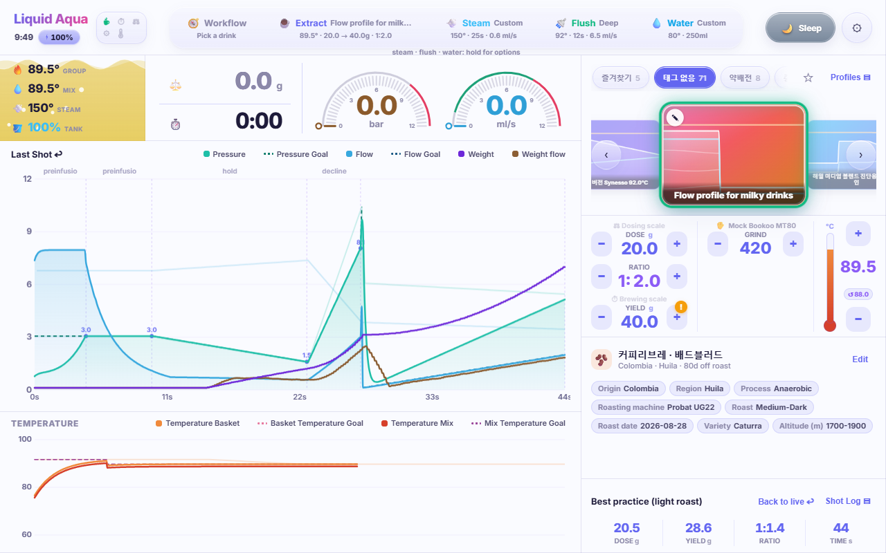

한 잔에 필요한 것이 모두 한 화면에 있습니다.
- 맨 위 줄에는 동작 버튼이 있고, 버튼마다 실행할 설정이 함께 적혀 있습니다.
- 그 아래에는 물탱크와 온도, 저울, 게이지가 놓입니다.
- 왼쪽은 추출 그래프와 온도 그래프가 채웁니다.
- 오른쪽에는 프로파일, 레시피, 원두, 마지막 샷이 있습니다.

스크롤도 없고, 메뉴 뒤에 숨은 것도 없습니다.

스킨은 파일 하나입니다. 마크업과 스타일, 자바스크립트가 모두 `index.html`에 들어 있습니다. 빌드 단계도, 의존성도 없습니다. Decaid 게이트웨이와는 `8080` 포트의 REST·WebSocket API로 통신하고, 같은 파일이 [폰 화면](#폰)도 띄웁니다.

---

## 목차

- [준비물](#준비물)
- [설치와 업데이트](#설치와-업데이트)
- [메인 화면](#메인-화면)
- [워크플로우](#워크플로우)
- [연결 기기](#연결-기기)
- [스팀 · 플러시 · 온수](#스팀--플러시--온수)
- [모니터](#모니터)
- [프로파일](#프로파일)
- [원두와 그라인더](#원두와-그라인더)
- [샷 기록](#샷-기록)
- [설정](#설정)
- [절전 화면](#절전-화면)
- [폰](#폰)
- [데이터가 저장되는 곳](#데이터가-저장되는-곳)
- [문제 해결](#문제-해결)
- [개발](#개발)

---

## 준비물

| | |
|---|---|
| 게이트웨이 | WebUI 서버를 켠 최신 Decaid |
| 화면 | 1280×800 기준. 다른 크기는 최대 1.6배까지 맞춰 늘어납니다 |
| 브라우저 | 최신 브라우저면 됩니다. Chrome, Safari, Android WebView에서 테스트합니다 |
| 선택 | Gemini, Claude, OpenAI 중 하나의 API 키. 봉투 읽기, 프로파일 추천과 다듬기, 샷 분석, 화면 번역 같은 AI 기능에 씁니다 |

그 밖에 필요한 것은 없습니다. 계정, 클라우드 서비스, 사용 기록 전송이 모두 없습니다. AI 기능은 전부 선택 사항이고, 추출 피드백, 프로파일 태그, 추출량 경고는 키 없이도 동작합니다.

## 설치와 업데이트

**설치.** Decaid의 스킨 관리 화면에서 GitHub 릴리스로 설치하고 `SongPaul/liquid-aqua-skin`을 지정합니다. API로도 설치할 수 있습니다.

```bash
curl -X POST http://<gateway>:8080/api/v1/webui/skins/install/github-release \
     -H 'Content-Type: application/json' \
     -d '{"repo":"SongPaul/liquid-aqua-skin"}'
```

`tag`를 빼면 최신 릴리스를 받습니다.

**업데이트.** 업데이트는 스킨이 아니라 Decaid 앱에서 설치합니다. 최신 Decaid는 스킨 업데이트, 플러그인 변경, 자동 업데이트 켜기에 관리 토큰을 요구하는데, 스킨은 그 토큰을 만들 수 없기 때문입니다. 앱에서 다음 순서로 진행합니다.

1. 대시보드에서 **Web Interface**를 엽니다.
2. 오른쪽 위 메뉴를 엽니다.
3. **Check for updates**를 누릅니다.

설정 › 업데이트 › 스킨에는 릴리스 기록이 있고, 새 버전이 나오면 알려 줍니다. Decaid 0.9.3부터는 태블릿에서 열었고 앱의 자동 업데이트가 켜져 있으면, 같은 화면에 **업데이트 확인** 버튼도 나옵니다. 같은 화면에는 **새로고침** 버튼이 항상 있어서, 앱을 다시 시작하지 않고도 새로 설치한 버전을 띄울 수 있습니다. 화면이 이전 버전이라고 알 수 있을 때는 강조되고, 머신이 동작하는 동안에는 새로고침하지 않습니다.

**개발용.** 폴더를 서버로 띄우고 브라우저로 엽니다. 게이트웨이는 스킨이 알아서 찾습니다.

```bash
python -m http.server 8081
```

---

## 메인 화면

### 상단 바

왼쪽에는 이름, 시계, 태블릿 배터리가 있습니다. 그 옆의 **연결 버튼**에는 기기마다 작은 아이콘이 있습니다. 머신, 저울, 그라인더는 늘 보이고, 온도계와 원두 계량기는 그 플러그인을 켰을 때 나타납니다. 연결된 기기는 초록색이 되고, 버튼을 누르면 [연결 기기](#연결-기기) 창이 열립니다.

가운데 버튼에는 각각 실행할 설정이 함께 적혀 있습니다.

| | 표시 | 누르면 |
|---|---|---|
| **워크플로우** | 지금 만드는 음료 | [워크플로우](#워크플로우)가 열림 |
| **추출** | 프로파일, 온도, 도징 → 추출량, 비율 | 추출 시작 |
| **스팀** | 프리셋 이름, 온도, 시간, 유량 | 스팀 시작 |
| **플러시** | 프리셋 이름, 온도, 시간, 유량 | 플러시 시작 |
| **물** | 프리셋 이름, 온도, 양 | 온수 시작 |

스팀, 플러시, 물은 길게 누르면 옵션이 열립니다. 머신에 GHC(그룹헤드 버튼)가 있으면 동작은 머신 버튼으로 시작하므로, 짧게 눌러도 옵션이 열립니다. 스킨이 이를 알아차리고 표시도 그에 맞게 바꿉니다.

오른쪽에는 **절전**과 **⚙** [설정](#설정)이 있습니다. **절전**을 길게 누르면 머신을 재우고 Decaid 앱에서 나갑니다. 안드로이드에서는 머신 연결을 유지한 채 앱이 뒤로 가고, 데스크톱은 앱이 종료됩니다. iOS는 앱이 스스로 나갈 수 없어서, 길게 눌러도 일반 절전과 같습니다.

### 물탱크 · 저울 · 게이지

**물탱크**는 아래에서부터 차오르고 물결이 잔잔하게 움직입니다. 색은 **믹스 온도**, 즉 실제로 커피에 닿는 물의 온도를 따릅니다.
- 80 °C까지는 파란색입니다.
- 80~95 °C에서는 1도마다 한 단계씩 청록, 초록, 노랑, 주황으로 바뀝니다.
- 95 °C 이상은 빨간색입니다.

탱크 위에는 그룹, 믹스, 스팀 온도와 수위가 표시됩니다.
- 물이 흐르는 동안에는 물방울이 올라오고, 물결이 머신 유량에 따라 빨라집니다. 8 ml/s에서 평소의 약 2.5배입니다.
- 물이 정말 부족하면 온도와 상관없이 빨간색이 됩니다.
- 리필 키트가 물을 받지 못해 멈추면 **급수 멈춤**으로 표시됩니다. 이때는 탱크가 아니라 급수를 확인하세요.
- 리필 키트를 단 직수 머신은 항상 가득 찬 것으로 보입니다.

그 옆에는 실시간 **무게**와 **타이머**가 있습니다. 무게를 누르면 영점을 잡습니다.

압력과 유량은 **게이지**로 보여 줍니다. 구간은 **로드된 프로파일**에서 읽어 오므로, 같은 바늘 위치라도 프로파일에 따라 뜻이 달라집니다. 게이지는 동작에 따라 바뀝니다. 온수 중에는 왼쪽이 믹스 온도를, 스팀 중에는 오른쪽이 스팀 유량을 보여 줍니다.

| 구간 | |
|---|---|
| 회색 | 한참 모자람. 퍽이 전혀 압력을 받지 못하고 있음 |
| 주황 | 모자람. 대개 분쇄가 너무 굵음 |
| **초록** | **프로파일대로**. 프로파일이 원한 범위 |
| 빨강 | 넘침. 프로파일이 원한 것보다 세게 밀고 있음 |

### 그래프

**추출 그래프**에는 다음이 그려집니다.
- 압력, 유량, 무게, 무게 유량
- 프로파일 목표(점선)
- 위쪽에 표시되는 단계 이름

그 아래 **온도 그래프**는 시간축을 공유해서, 위아래가 같은 순간을 가리킵니다. 범례를 누르면 그 선을 숨기거나 다시 보여 줍니다.

- 스팀, 플러시, 온수 중에는 두 그래프가 그 동작용으로 바뀝니다.
- **추출 가이드라인**(설정 › 일반 › 화면)을 켜면, 실시간 그래프 아래에 이번 샷이 그려야 할 모양이 깔립니다. 기준은 로드된 프로파일이거나, 샷 기록에서 고른 지난 샷입니다.
- 마지막 샷 카드의 **그래프 보기**를 누르면 그 샷의 기록이 그래프에 올라옵니다. **실시간으로**를 누르면 돌아옵니다.
- **그래프를 누르면** [모니터](#모니터)가 열립니다.

### 프로파일

캐러셀은 프로파일을 커버로 보여 줍니다. 커버마다 그 프로파일의 곡선이 그려지고, **초록 테두리**가 있는 것이 머신에 로드된 프로파일입니다.

- 위쪽 탭은 **즐겨찾기**, **태그 없음**, 그리고 메인 화면에 보이도록 고른 태그들입니다.
- **가운데 커버를 누르면** 로드됩니다. 밀거나 화살표로 넘깁니다.
- **☆**로 즐겨찾기에 넣고 뺍니다. **목록**을 누르면 [프로파일 목록](#프로파일)이 열립니다.
- 추출 중에는 프로파일이 잠깁니다.
- 설정에서 **카메라**를 켜면 앨범 자리에 카메라 화면이 나옵니다. 거기 뜨는 코드를 폰으로 스캔해서, 그 폰의 카메라나 IP 카메라 앱의 영상을 보낼 수 있습니다.

### 레시피

캐러셀 아래가 레시피입니다.

| | |
|---|---|
| **도징** | 누르면 입력합니다. 도징 저울이 있으면 그 저울 값이 보입니다. 짧게 누르면 그 값을 가져오고, 길게 누르면 직접 입력합니다. **⚖**는 도징 저울 영점입니다 |
| **추출 비율** | 도징은 두고 추출량을 바꿉니다 |
| **추출량** | 추출 저울로 잽니다. 도징을 바꾸면 추출량도 함께 따라갑니다 |
| **분쇄도** | 그라인더에 맞는 단위로 움직입니다. 그라인더 플러그인이 있으면 그라인더에 바로 보냅니다 |
| **추출 온도** | 온도계 모양 칸입니다. 바꾸면 프로파일 전체 온도가 그만큼 오르내립니다. **↺**를 누르면 프로파일 원래 온도로 돌아갑니다 |

불러온 프로파일이 추출량 근처나 그 전에 스스로 끝나면(시간이 다 되거나, 저울 없이 자체 부피에 닿거나, 마지막 단계가 무게로 끝나는 경우) 추출량 밑에 어디서 멈추는지 작게 표시됩니다. 추출량보다 적으면 주황색입니다. 이전 샷에서 프로파일이 먼저 끝난 적이 있으면 추정치 대신 그때 실제로 나온 양을 보여 줍니다. 추출량은 다른 스킨처럼 프로파일의 목표 무게로도 보냅니다.

### 원두와 마지막 샷

원두 카드에는 쓰는 원두, 로스팅 후 경과일, 세부 정보가 나옵니다. **편집**을 누르면 [원두와 그라인더](#원두와-그라인더) 화면이 열립니다. [원두 계량기](#원두-계량기)가 연결되면 **XDOSING** 탭이 생깁니다.

마지막 샷 카드에는 그 샷의 프로파일, 도징, 추출량, 비율, 시간이 나옵니다. **샷 기록**을 누르면 [샷 기록](#샷-기록)이 열립니다. [추출 피드백](#추출-피드백)에서 추출량이나 시간이 벗어나면 그 숫자가 주황색으로 바뀌고 작은 화살표(적음/많음, 짧음/김)가 붙습니다. 채널링, 분쇄 굵음·고움, 온도 이탈은 프로파일 이름 옆에 작은 태그로 표시되고, 누르면 샷 기록이 열립니다.

---

## 워크플로우

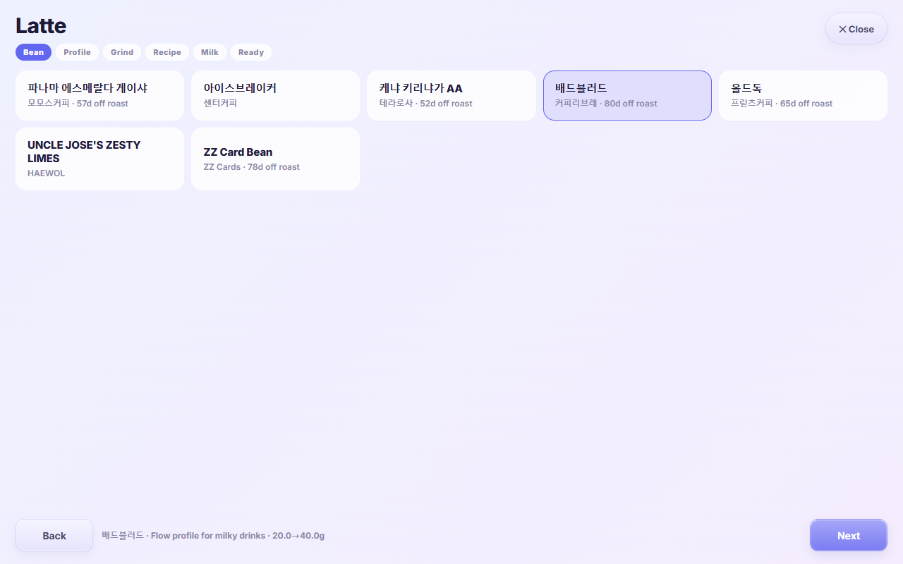

상단 바의 **워크플로우**는 음료를 단계별로 준비합니다. 음료는 세 가지입니다.
- **에스프레소**
- **아메리카노**: 에스프레소 다음에 온수
- **라떼**: 에스프레소 다음에 스팀 우유

위쪽 줄에 단계가 나옵니다. 원두, 프로파일, 분쇄도, 레시피를 거쳐 물이나 우유로 이어지고, 단계마다 최근에 쓴 것을 먼저 보여 줍니다.

끝나면 모든 설정이 이미 머신에 들어가 있습니다. 추출은 **추출** 버튼이나 그룹헤드에서 시작합니다. 워크플로우는 준비만 하고, 머신을 직접 켜지는 않습니다.

---

## 연결 기기

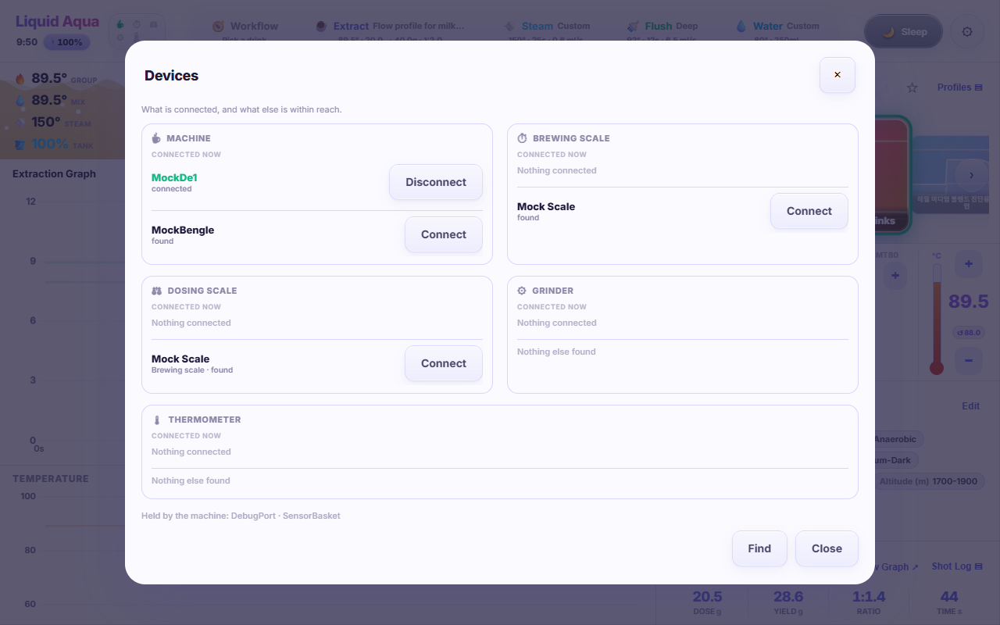

상단 바의 연결 버튼을 누르면 열립니다. 기기 종류마다 칸이 나란히 있고, 칸 위쪽에는 지금 연결된 기기, 그 아래에는 **근처에서 찾은 기기**가 나옵니다. 빈 칸은 제목 줄에 "연결 없음"만 보여 주고 자리를 차지하지 않습니다. 추출 저울은 도징 저울 목록에, 도징 저울은 추출 저울 목록에 나오지 않습니다.

| 칸 | |
|---|---|
| 머신 | DE1 |
| 추출 저울 | 샷 무게를 재는 저울. 게이트웨이가 알아서 다시 연결합니다 |
| 도징 저울 | 도징을 재는 두 번째 저울. 이 스킨만 붙잡고 있고, 샷 무게에는 쓰지 않으며, 앱을 닫으면 놓아 줍니다 |
| 그라인더 | 플러그인으로 움직이는 그라인더 |
| 온도계 | 온도계 플러그인을 켜면 나타납니다 |
| 원두 계량기 | RedxKey 계량기 플러그인을 켜면 나타납니다 |

**찾기**(닫기 버튼 옆)는 아무것도 연결하지 않고 다시 둘러봅니다. 게이트웨이는 저울을 하나 잡으면 더 찾지 않기 때문에, 나중에 켠 저울은 이 버튼으로만 찾을 수 있습니다. 찾는 동안에도 근처 기기 목록은 그대로 남아 있습니다.

다른 스킨처럼 이 스킨도 스스로 스캔하지 않습니다. 스캔은 이미 연결된 기기들과 블루투스 무선을 나눠 쓰기 때문입니다. 안 보이는 도징 저울은 레시피 카드에서 그 저울을 누를 때 찾습니다. 스킨이 스스로 연결하는 기기는 차례를 지킵니다. 머신, 그다음 추출 저울이 연결되어 안정된 뒤에 도징 저울을 연결합니다.

---

## 스팀 · 플러시 · 온수

상단 바에서 누르면 바로 실행되고, 길게 누르면 옵션이 열립니다. 동작마다 이름 붙인 프리셋을 세 개까지 둘 수 있고, 화면의 숫자를 그대로 프리셋으로 저장할 수 있습니다.

**동작이 도는 동안**에는 레시피 카드가 그 동작의 숫자를 바로 바꾸는 조절판으로 바뀝니다. 누르는 즉시 반영되고, 여러 번 누른 것은 스킨이 모아서 한 번에 보냅니다.

| | |
|---|---|
| 스팀 | 온도, 시간, 유량 |
| 플러시 | 온도, 시간, 유량 |
| 온수 | 온도, 양, 시간, 유량 |

설정 › 머신 › **온수** 탭에서 Streamline처럼 유량, 저울 정지 스위치 하나, 컵이 목표에 딱 맞게 얼마나 일찍 멈출지를 정합니다. 그 아래 **온수 기록**에는 최근 온수마다 목표, 컵에 담긴 양(멈춘 순간과 방울이 떨어진 뒤), 머신이 센 물량과 보낸 한도, 걸린 시간, 무엇이 멈췄는지가 나옵니다. 멈춘 원인은 스킨의 저울 정지, 스킨의 버튼, 게이트웨이의 저울 정지, 머신 자체 물량 계산, 머신 시간 제한, 물탱크 부족, 그 밖(그룹헤드 버튼 등) 중 하나로 표시됩니다. **복사**를 누르면 유량과 무게 흐름까지 담긴 전체 기록이 클립보드에 들어갑니다. Streamline의 시간 제한은 넣지 않았습니다. 양이 설정돼 있으면 머신이 시간 제한을 무시하기 때문입니다([decaid #1128](https://github.com/decentespresso/decaid/issues/1128)).

어떤 머신은 펌프로 센 자기 추정량이 컵보다 훨씬 먼저 차서 게이트웨이 저울 정지가 걸리기 전에 멈춥니다([decaid #1119](https://github.com/decentespresso/decaid/issues/1119)). 그래서 저울이 있고 **온수 저울 정지**가 켜져 있으면(기본값) 설정한 양과 상관없이 머신에는 250 ml를 보내고, 컵이 설정한 양에 닿으면 스킨이 멈춥니다(de1app 방식). 게이트웨이의 저울 정지도 뒤에서 켜 둡니다. 온수 중에 컵을 놓거나 들거나 영점이 늦게 잡혀 무게가 갑자기 바뀌면 물로 치지 않습니다. 끄면 두 정지가 모두 꺼지고, 설정한 양을 머신에 보내 머신이 자기 추정량으로 멈춥니다. 게이트웨이 스위치는 다른 스킨과 함께 쓰므로 거기서도 꺼집니다. 저울이 없으면 언제나 머신이 자기 추정량으로 멈춥니다. **머신 물량 계산 쓰지 않기**(기본 꺼짐, 온수 저울 정지가 켜져 있고 저울이 연결돼 있을 때만)는 물량을 실제보다 많게 세는 머신을 위한 옵션입니다. 켜면 머신에 물량 한도 없이 시간 상한(설정 유량의 절반 속도로 목표를 채우는 시간 + 5초)만 보내므로, 머신 계산이 컵이 목표에 닿기 전에 온수를 끝내지 못합니다([decaid #1128](https://github.com/decentespresso/decaid/issues/1128)). 스킨이나 저울 연결이 끊기면 그 시간 상한까지 계속 나옵니다. 설정할 수 있는 양은 머신이 받는 최대치인 250 ml까지입니다. 스킨이 꺼진 채 그룹헤드에서 시작하면 최대 250 ml까지 나올 수 있습니다.

### 우유 온도계

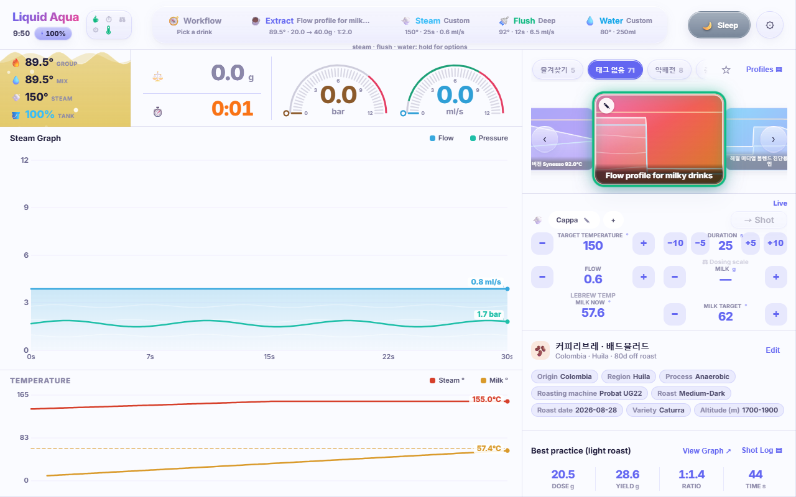

[LEBREW TEMP](https://github.com/SongPaul/lebrew-temp-plugin) 같은 온도계 플러그인을 켜면 스팀 카드에 두 칸이 생깁니다.

- **우유 온도**: 온도계가 잰 값입니다. 목표에 닿으면 초록색이 됩니다.
- **우유 목표**: 스팀을 멈출 온도로, 30~90 °C 또는 *끔*입니다.
  - 워크플로우의 `steamSettings.stopAtTemperature`로 저장되고, 멈추는 것은 게이트웨이가 합니다.
  - 스킨이 따로 정지를 보내지 않는 데는 이유가 있습니다. 두 번째 정지 요청은 2단계 스팀 퍼지 설정의 두 번째 탭으로 처리돼 바로 퍼지가 시작되기 때문입니다.

스팀 중에는 온도 그래프에 우유 온도가 주황색 선과 현재 값으로 그려지고, 우유 목표는 점선으로 나옵니다. 범례의 **우유 °**를 누르면 선을 숨기거나 다시 보여 줍니다.

도징 저울이 있으면 스팀 카드에서 우유 무게도 잽니다. **샷에 →**를 누르면 그 무게가 마지막 샷의 메모에 기록됩니다.

### 원두 계량기

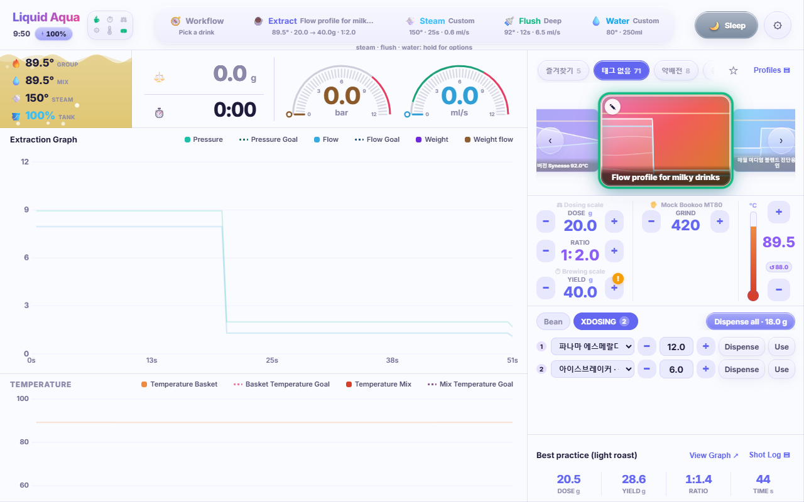

RedxKey 원두 계량기 플러그인(`redxkey.reaplugin`)을 켜면 연결 기기 창에 **원두 계량기** 칸이 생깁니다. 모듈은 한 번에 네 개까지 연결할 수 있는데, 이는 플러그인 하나당 게이트웨이 한도입니다. 모듈이 하나라도 연결되면 원두 카드에 **원두**와 **XDOSING** 두 탭이 생기고, XDOSING 탭에는 연결된 모듈 수가 함께 나옵니다.

- XDOSING에는 연결된 모듈이 한 줄씩 나옵니다. 줄마다 번호, 원두, 그램, **배출**, **선택**이 있고, **모두 배출 · N g**은 탭 옆에 있습니다.
- 모듈마다 원두 목록에서 원두를 지정할 수 있습니다. 원두와 그램은 이 태블릿에 모듈 이름별로 저장됩니다.
- 그램은 0~25.5 g, 0.1 g 단위입니다. 모듈이 하나이고 저장된 값이 없으면 레시피 도징량으로 시작합니다.
- 배출한 모듈의 원두가 레시피 원두가 되어, 다음 샷이 그 원두로 저장됩니다.
  - **모두 배출**은 가장 많이 배출한 모듈의 원두를 씁니다.
  - **선택**은 배출하지 않고 같은 일을 합니다.
- 배출이 끝나면 모듈 번호가 초록색이 됩니다. 실패했거나 배출됐을 수 있으면 주황색이 됩니다.
- 시작 신호를 보낸 뒤 실패하면 실제로는 배출됐을 수 있습니다. 그래서 그 모듈로 다시 배출할 때 먼저 묻습니다.

---

## 모니터

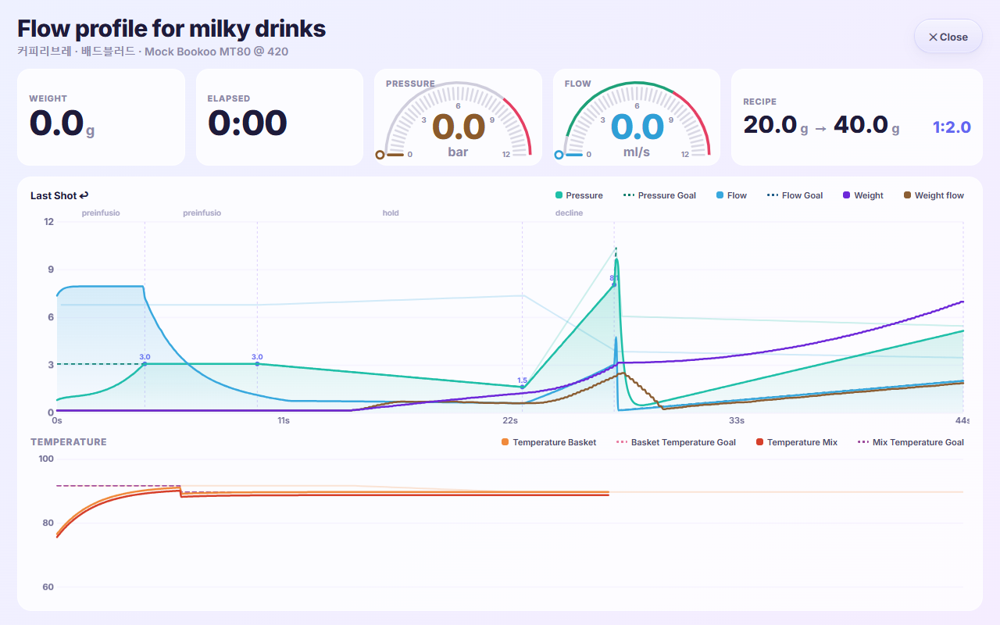

동작 하나를 전체 화면으로 보여 줍니다. 지켜볼 만한 그래프와, 멀리서도 읽힐 크기의 숫자가 나옵니다.
- 동작이 시작되면 저절로 열립니다.
- 어떤 동작에서 열고, 끝나면 다시 닫을지는 설정 › 일반 › 화면에서 고릅니다.
- 그래프를 누르면 언제든 열립니다.

| | |
|---|---|
| 제목 | 샷이면 프로파일, 그 아래에 원두, 그라인더, 분쇄도. 스팀, 플러시, 온수는 동작 이름 |
| 무게 · 경과 | 멀리서도 읽히는 크기 |
| 게이지 두 개 | 메인 화면과 같은 구간 |
| 레시피 | 샷은 도징 → 추출량과 비율, 다른 동작은 그 동작의 설정 |
| 그래프 | 위에 추출, 아래에 온도. 시간축은 같습니다 |

**닫기는 화면만 닫고 머신은 멈추지 않습니다.**
- 동작이 도는 동안 모니터에는 따로 **정지** 버튼이 있습니다.
- GHC가 있으면 시작과 정지를 그룹헤드가 맡으므로 정지 버튼은 숨겨집니다.
- 모니터는 동작이 끝나도 닫을 때까지 남아 있어서 결과를 읽을 수 있습니다.

---

## 프로파일

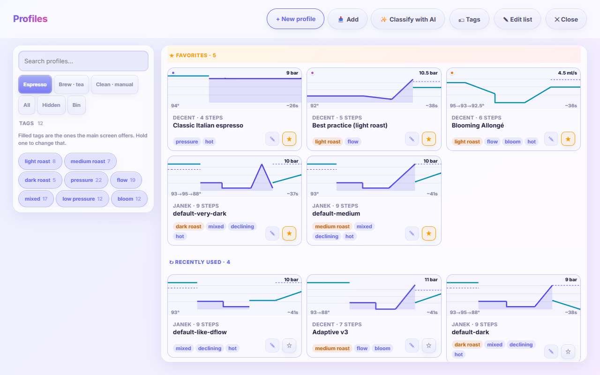

메인 화면의 **목록**을 누르면 열립니다. 프로파일마다 곡선, 최고 압력 또는 유량, 온도, 예상 시간이 담긴 카드로 나옵니다.

- **검색**은 이름과 메모를 함께 찾습니다. **에스프레소 / 브루·티 / 청소·수동 / 전체**, **숨김**, **휴지통**으로 거를 수 있습니다.
- 목록은 **즐겨찾기**와 **최근 사용**을 먼저 보여 주고, 나머지가 뒤에 옵니다.
- **태그**는 두 가지에서 옵니다.
  - 프로파일 모양에서 자동으로 붙는 태그: 압력, 유량, 혼합, 저압, 블루밍, 감압, 고온, 저온
  - 직접 지정한 배전도
  - 채워진 태그가 메인 화면에 탭으로 나옵니다. 태그를 길게 누르면 메인 화면 표시 여부를 바꿉니다.
  - 위쪽 **태그 편집**에서는 모든 프로파일에 걸쳐 태그 이름을 바꾸거나 지우고, 여러 개를 고를 수 있습니다.
- **✨ AI 자동 분류**는 전체 목록을 한 번 읽고 프로파일마다 배전도 태그를 붙입니다.
- **+ 새 프로파일**로 새로 만듭니다.
- **불러오기**는 두 곳에서 가져옵니다.
  - Visualizer: 공유 코드, 샷 링크, 커뮤니티 둘러보기
  - `.tcl`·`.json` 파일: 폴더째로도 됩니다
- **목록 편집**은 여러 프로파일을 골라 한꺼번에 숨기거나, 보이거나, 지웁니다.
  - 지운 프로파일은 휴지통으로 가고, 거기서 되돌릴 수 있습니다.
  - 앱에 기본으로 들어 있는 프로파일은 지우는 대신 숨겨집니다.

### 편집기

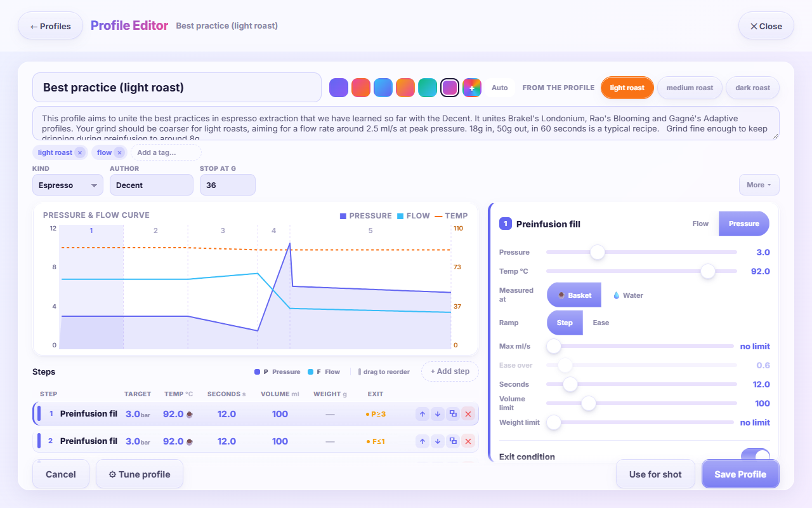

위쪽에서는 프로파일 정보를 편집합니다.
- 이름, **카드 색**, **배전도**
- 메모, 태그, 종류, 작성자, 멈출 무게
- **더보기**를 누르면 프로파일이 가진 나머지 항목이 열립니다.

아래쪽은 단계를 다루는 곳입니다.
- **곡선**은 단계마다 압력, 유량, 온도를 그립니다. 곡선의 한 구간을 누르면 그 구간을 그린 단계가 편집됩니다.
- **단계 표**에는 단계마다 목표, 온도, 시간, 부피, 무게, 종료 조건이 나옵니다. 끌어서 순서를 바꾸고, 버튼으로 옮기거나 복제하거나 지웁니다.
- 오른쪽 **단계 패널**은 단계 하나를 편집합니다.
  - 압력 또는 유량, 온도와 측정 위치(바스켓 / 물)
  - 램프(즉시 / 완만), 제한값
  - 시간, 부피·무게 한도, 종료 조건
- **프로파일 다듬기**는 이 프로파일로 내린 샷들을 AI에 보냅니다.
  - 이미 있는 단계의 값만 조정하고, 단계를 더하거나 빼거나 이름을 바꾸지는 않습니다.
  - 결과는 사본으로 저장하거나 이 프로파일에 덮어씁니다.
- **샷에 사용**은 화면에 있는 그대로를 로드하므로, 저장하지 않은 수정도 머신에 들어갑니다. **프로파일 저장**은 저장합니다.

---

## 원두와 그라인더

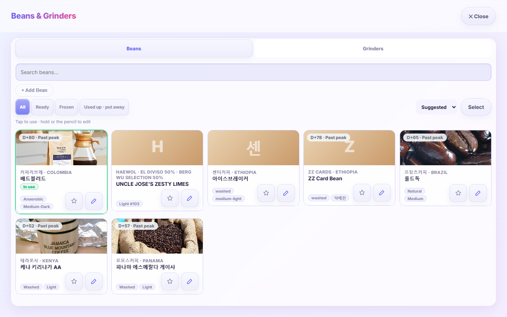

원두 카드의 **편집**이나 레시피의 그라인더 이름을 길게 눌러서 엽니다. 원두와 그라인더는 카드로 나옵니다. **누르면 그것을 쓰고**, 길게 누르거나 연필을 누르면 편집합니다.

- 원두 카드에는 봉투 사진, 로스팅 후 경과일, 숙성 상태(**숙성 중**, **적기**, **지나는 중**, **지남**, **냉동**)가 나옵니다.
- **전체 / 적기 / 냉동 / 다 씀 · 보관**으로 거르고, **추천순**, 로스팅일, 이름순으로 정렬합니다.
- **선택**을 누르면 여러 원두를 한꺼번에 보관하거나, 되돌리거나, 지울 수 있습니다.

### 원두

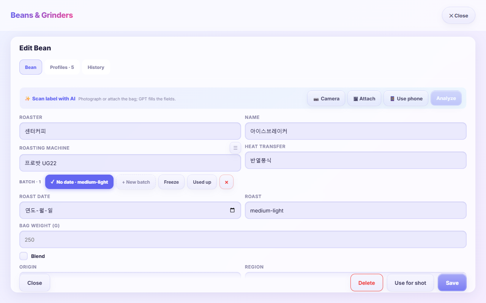

같은 커피는 원두 하나입니다. 다시 살 때마다 **배치**가 하나씩 생기고, 배치마다 로스팅일, 배전도, 봉투 무게가 따로 있습니다. 원두에는 바뀌지 않는 정보가 담깁니다.
- 로스터리, 이름, 로스터기와 그 열전달 방식
- 원산지, 지역, 생산자, 가공, 품종, 고도, 종, 디카페인
- **블렌드**는 구성 커피와 비율을 적습니다.

원두 편집에서 할 수 있는 일은 다음과 같습니다.
- **냉동**과 **다 씀**으로 배치 상태를 표시합니다. 봉투 무게를 적어 두면 샷 수를 세서 남은 양을 어림합니다.
- **✨ AI로 라벨 스캔**은 봉투 사진(최대 다섯 장)으로 양식을 채웁니다.
  - 태블릿에서는 **카메라**와 **첨부**를 씁니다.
  - **폰 사용**을 누르면 QR 코드가 나옵니다. 폰으로 봉투를 찍으면 결과가 게이트웨이에 바로 저장됩니다.
  - 봉투에 적힌 말은 그 언어 그대로 남깁니다.
  - 봉투에 없고 검색으로 찾은 정보에는 확인해 보라는 표시가 붙습니다.
  - 이미 있는 커피를 스캔하면, 중복 원두 대신 **새 배치**로 추가할지 묻습니다.
- 봉투 사진은 원두마다 세 장까지 보관합니다. 사진은 원두 커버가 되고, [절전 화면](#절전-화면)도 채웁니다.
- **샷에 사용**은 원두를 워크플로우에 넣어, 샷마다 어떤 원두로 내렸는지 기록되게 합니다.

### 이 원두의 프로파일

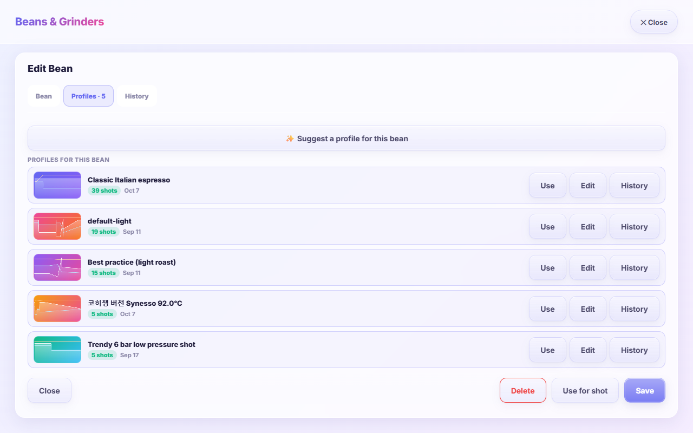

어디서 왔든 한 목록에 모입니다. 줄마다 프로파일 곡선, 이 원두로 몇 번 내렸는지, 언제 마지막으로 썼는지가 나옵니다. **사용**은 로드하고, **편집**은 편집기로 열고, **기록**은 그 프로파일로 내린 샷만 보여 줍니다.

**✨ 이 원두에 맞는 프로파일 추천**은 *설치된* 프로파일 중 이 커피에 맞는 것을 AI에 물어 다섯 개를 순위대로 고릅니다. 결과는 원두와 함께 저장되므로, 다시 열어도 API를 다시 부르지 않습니다.

### 이 원두 기록

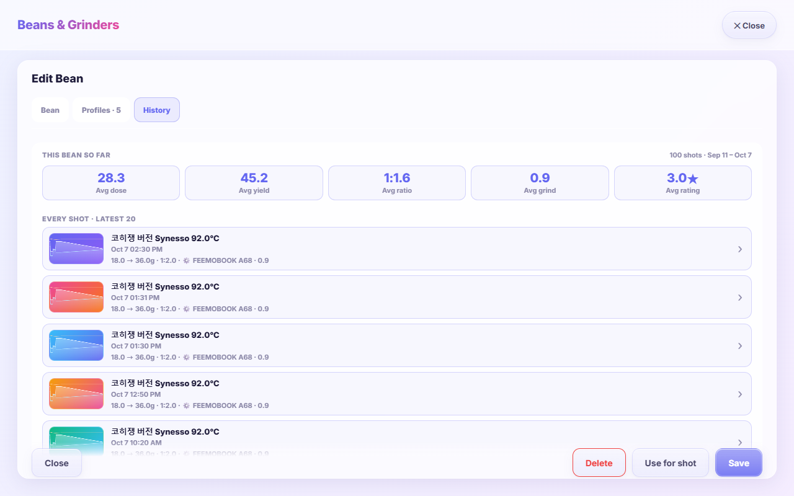

이 커피의 샷 기록입니다.
- 평균 도징, 추출량, 비율, 분쇄도, 평점
- 샷 수와 기간
- 최근 20샷

샷을 누르면 샷 기록에서 열립니다.

### 그라인더

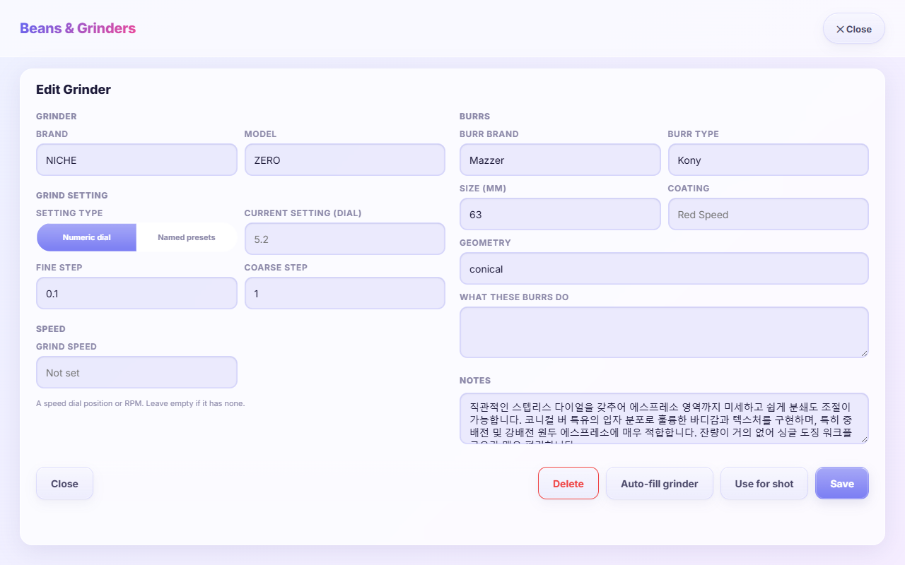

그라인더는 **브랜드**와 **모델**, 분쇄도 방식, 선택 사항인 속도, 그리고 버로 이루어집니다.

- 분쇄도는 두 방식 중 하나입니다.
  - **숫자 다이얼**: 미세·거친 단계를 직접 정합니다.
  - **이름 단계**: 이름 붙인 단계를 나열합니다.
- **버**에는 버 브랜드, 종류, 크기, 코팅, 형태를 적고, 그 버의 특성도 메모합니다.
- **그라인더 자동입력**은 브랜드와 모델로 그라인더를 찾아 빈 칸만 채웁니다. 버 크기는 절대 추측하지 않게 되어 있어서, 모르는 그라인더면 그럴듯한 값 대신 빈 칸으로 둡니다.
- 플러그인으로 움직이는 그라인더(Bookoo MT80, xBloom, Eureka E64 등)는 저절로 추가되고 **연동** 표시가 붙습니다.
  - 이름과 다이얼은 플러그인을 따릅니다.
  - 쓰는 동안에는 레시피 카드가 분쇄도를 직접 맞춥니다.
  - 그라인더 플러그인은 설정 › 플러그인에서 설치합니다.

AI 샷 분석과 프로파일 추천은 둘 다 그라인더 정보를 함께 받습니다. 그래서 분쇄도 조언이 *사용자의 다이얼* 기준으로 나옵니다.

---

## 샷 기록

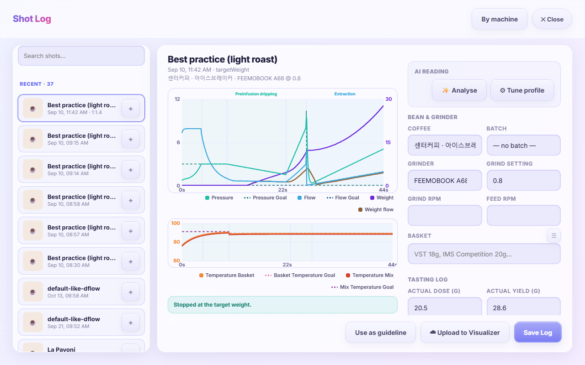

기록된 샷이 최신순으로 나옵니다. 검색창 옆의 **★ 4+**를 누르면 최근 200샷 중 별 네 개 이상 준 샷만 보여 줍니다. 샷을 고르면 왼쪽에 기록이, 오른쪽에 기록할 내용이 나옵니다.

**왼쪽:** 실제로 일어난 그대로의 추출·온도 그래프, 위쪽의 단계 이름, 그리고 샷이 끝난 이유("목표 무게에서 멈췄습니다")가 나옵니다.

**오른쪽:**

| | |
|---|---|
| AI 추출 분석 | **분석**과 **프로파일 다듬기** |
| 원두 & 그라인더 | 샷에 기록된 커피, 배치, 그라인더, 분쇄도, 속도. 원두를 잘못 걸었으면 여기서 고칩니다 |
| 바스켓 | 내 바스켓 목록에서 고릅니다 |
| 테이스팅 기록 | 실제 도징과 추출량, TDS, 추출 수율, 그리고 맛 평가 카드. 산미, 쓴맛, 단맛, 바디, 떫은 마무리, 여운, 한 잔 더 마시고 싶은지를 적습니다 |

아래쪽 버튼은 세 가지입니다.
- **가이드로 사용**: 이 샷을 실시간 그래프 아래에 깝니다.
- **Visualizer 업로드**: 샷을 보내고, 이미 올라가 있으면 갱신합니다.
- **기록 저장**: 게이트웨이에 저장합니다.

**로스터기별**은 샷을 로스터리의 로스터기, 열전달 방식, 배치 크기로 묶어 보여 줍니다. 기계를 평가하는 것이 아니라, 내가 어떻게 맞춰 왔는지의 기록입니다.

### 추출 비교

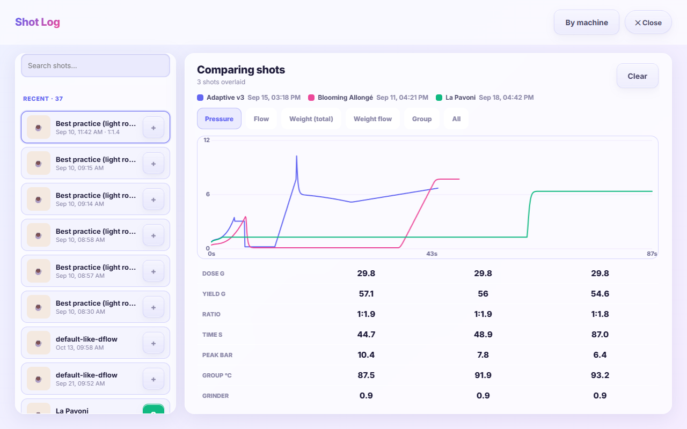

목록의 줄마다 오른쪽에 **+**가 있습니다. 누르면 그 샷이 비교에 들어가면서 색이 정해지고, 최대 네 샷까지 비교할 수 있습니다.

두 샷 이상 고르면 상세 화면이 겹쳐 보기로 바뀝니다. 측정값 하나를 모든 샷에 걸쳐 같은 축에 그립니다.
- **압력 / 유량 / 무게 / 무게 유량 / 그룹**으로 측정값을 고릅니다.
- **전체**는 모든 측정값을 점선 모양으로 구분해 한꺼번에 그립니다.
- 아래 표에는 샷마다 한 열씩 도징, 추출량, 비율, 시간, 최고 압력, 그룹 온도, 분쇄도, TDS, EY, 평점이 나옵니다.
- **해제**를 누르면 샷 하나 보기로 돌아갑니다.

### 추출 피드백

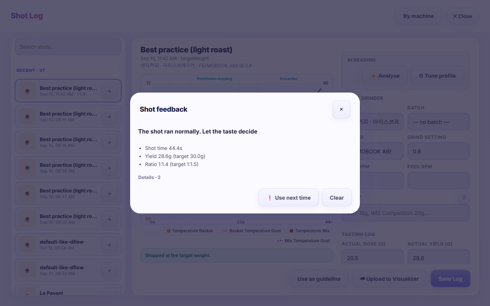

샷이 끝나면 압력, 유량, 무게를 그 자리에서 점검합니다. AI도 네트워크도 쓰지 않습니다. 이전 샷 카드에는 벗어난 숫자만 작게 표시되고, 곡선이 기록된 샷이면 샷 기록에서 다음 내용을 모두 볼 수 있습니다.

- 판정: 정상, 빨리 흐름(분쇄가 굵음), 막힘(분쇄가 가늚), 채널링, 신호가 엇갈림
- 추출 시간, 추출량, 비율을 목표와 비교한 값, 퍽 저항, 추출 수율
- 프로파일이 목표 무게 전에 끝났다면, 마지막 단계에 몇 초를 더 줘야 하는지, 또는 추출량을 얼마로 맞추면 되는지

샷 기록에서 **다음 추출에 반영**을 누르면 제안이 저장되고, 그 프로파일을 다시 로드할 때 카드에 표시됩니다. 피드백은 설정 › 일반 › 화면에서 켜고 끕니다.

저울이 있으면 스킨은 **언제 멈출지**도 익힙니다.
- 샷마다 안정된 무게를 목표와 비교해서, 정지 시점을 조금씩 앞당기거나 늦춥니다.
- 바꾼 내용은 알림으로 알려 주고, **되돌리기**로 원래대로 돌릴 수 있습니다.
- 이 기능은 설정 › 머신 › 정지 시간 보정에서 끕니다.

### AI 추출 분석

**분석**은 샷을 AI에 보내 곡선이 어떻게 흘렀는지 묻습니다.
- **보내는 것:** 프로파일, 원두와 그라인더, 측정값, 테이스팅 메모, 그리고 약 24개 점으로 줄인 곡선입니다.
- **받는 것:** 판정, 몇 가지 관찰, 이유를 붙인 변경 제안 최대 세 개입니다.
- **비교에도 쓸 수 있습니다:** 이 샷들이 실제로 무엇이 다른지, 어느 쪽을 따라가면 좋을지 묻습니다.

결과는 이렇게 관리됩니다.
- 분석 결과는 해당 샷에 묶어 저장하므로, 샷을 다시 열어도 다시 부르지 않습니다.
- 제안에 **맞았음**이나 **아니었음**을 표시할 수 있습니다. 이 반응은 다음 분석에 함께 보내져서, 통하지 않았던 조언은 되풀이하지 않게 됩니다. 기억된 내용은 설정 › AI에서 보고 지울 수 있습니다.

---

## 설정

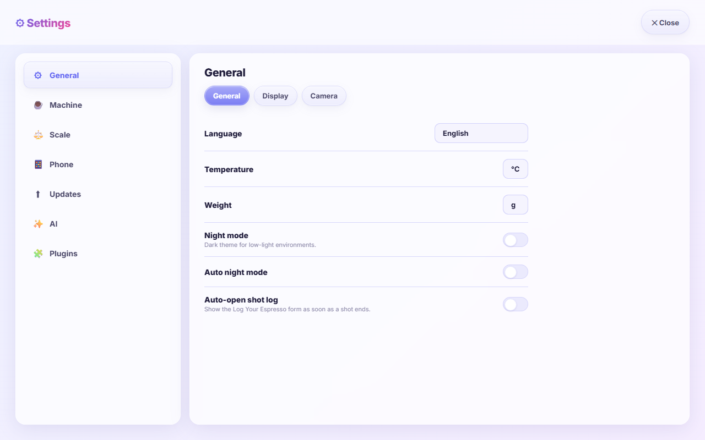

설정은 분류 목록이고, 분류마다 탭이 있습니다.

| 분류 | 탭과 내용 |
|---|---|
| **일반** | **일반**: 언어, °C/°F, g/oz, 야간 모드와 자동 야간 모드, 샷 기록 자동 열기, Decaid 대시보드로 가기. **화면**: 밝기, 화면 켜두기, 저전력 밝기 제한, 추출 가이드라인, 모니터를 열고 닫을 동작, 추출 후 분석, 화면 효과, 프레임 표시, 절전 화면의 사진·움직임·밝기. **카메라**: 앨범 자리의 카메라와 회전, 채우기, 확대, 좌우 반전 |
| **머신** | 탭 4개. **물탱크**(리필 경고, 리필 키트), **유량·정지**(정지 시간 보정과 자동 맞춤, 온수의 유량·저울 정지·스킨이 저울로 멈추기, 머신 유량 보정), **머신 설정**(USB 충전, 팬, 탱크 히터, 스팀 퍼지, 미사용 시 절전), **관리·정보**(그룹 청소, 디스케일, 에어 퍼지, 머신 정보, 읽기 전용 센서 보정) |
| **저울** | 저울 없으면 추출 막기, 타겟 도달 여유, 머신이 잠들 때 저울 처리 |
| **폰** | [폰 화면](#폰) 주소와 QR 코드 |
| **업데이트** | **펌웨어**(업데이트 또는 파일 업로드), Decaid **앱 업데이트**, **스킨** 릴리스 기록 |
| **AI** | 서비스(Gemini, Claude, OpenAI)와 키, 키 확인. **분석이 기억하는 것** |
| **플러그인** | 설치된 플러그인, 그라인더 플러그인과 GitHub 주소. Decaid 0.9.2부터는 플러그인 설치, 켜고 끄기, 설정을 Decaid 앱에서 하므로, 이 화면은 거절될 스위치 대신 그렇게 안내합니다 |

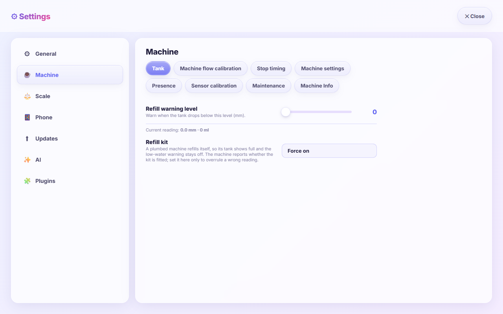

몇 가지 설정을 더 풀어 설명합니다.

- **언어**: 영어와 한국어가 기본으로 들어 있습니다. 그 밖에 열세 개 언어는 AI 키로 한 번 번역해 두고 계속 씁니다.
- **타겟 도달 여유**: 프로파일이 목표 무게 전에 시간으로 끝날 상황이면, 마지막 단계를 최대 20초까지 더 붙잡습니다. 샷은 여전히 목표 무게에서 멈추고, 저장된 프로파일은 바뀌지 않습니다.
- **머신 유량 보정**: DE1은 펌프 동작으로 유량을 어림하고, 이 배율은 온수뿐 아니라 에스프레소 유량에도 곱해집니다. 값은 스킨 키패드로 넣거나 0.01씩 조절하며, 머신에 쓴 뒤 다시 읽어 확인합니다. 온수 한 번으로 계산하지는 않습니다. 머신의 온수 오차가 유량마다 달라 한 번의 측정으로는 맞출 수 없기 때문입니다([decaid #1128](https://github.com/decentespresso/decaid/issues/1128)). 마지막으로 읽은 값을 바로 보여 주고 뒤에서 새로 읽습니다.
- **화면 효과**: 끄면 탱크 물결, 그래프 움직임, 커버를 스치는 빛, 터치 물결, 다른 화면의 유리 블러가 모두 멈춥니다. 끊기는 태블릿을 위한 설정입니다.
- **프레임 표시**: 초당 프레임을 보여 줍니다. 누르면 느렸던 프레임과 그 주변에서 돌던 일을 기록한 로그가 열립니다.

---

## 절전 화면

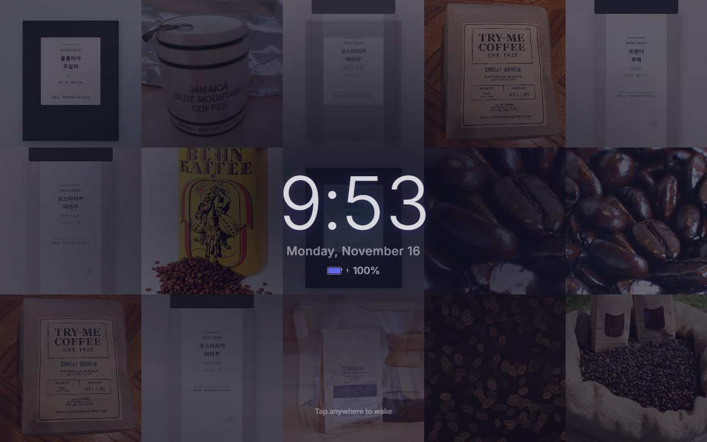

상단 바에서 절전을 누르거나 머신이 스스로 잠들면, 스킨도 따라 절전 화면이 됩니다. 시계, 날짜, 배터리가 봉투 사진 벽 위에 나옵니다. 사진이 모자라면 그려 둔 봉투로 채웁니다. 벽이 늘 움직일지, 가끔 움직일지, 멈춰 있을지는 설정 › 화면에서 정합니다.

전력을 거의 쓰지 않도록 만들었습니다.

- 화면 켜두기를 풀어서 태블릿의 화면 꺼짐 시간이 그대로 적용됩니다.
- 뒤의 화면은 그리지 않고, 애니메이션도 모두 멈춥니다.
- 밝기는 절전 밝기로 내려갔다가 깨어나면 돌아옵니다.
- 잠든 동안 할 말이 없는 소켓은 닫았다가 깨어나면 다시 엽니다. 머신 상태 소켓만 남겨 두므로, 그룹헤드에서 머신을 깨워도 알아챕니다.

원두, 프로파일, 샷 기록, 설정 같은 전체 화면 페이지가 열려 있는 동안에도 마찬가지로 뒤의 화면은 그리지 않습니다.

---

## 폰

<p>
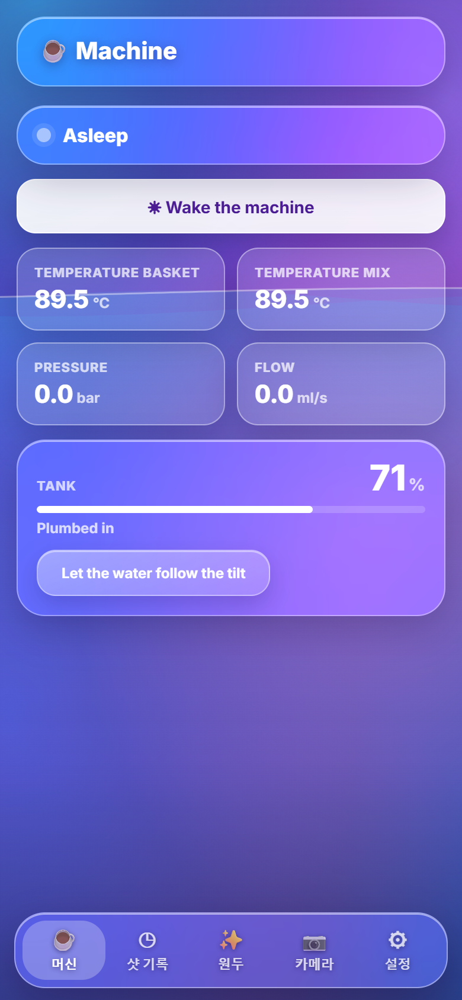
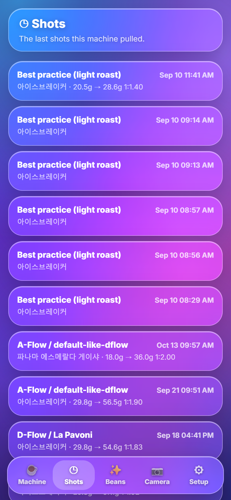
</p>

설정 › 폰에 나오는 주소를 폰에서 열면 폰 화면이 뜹니다. 홈 화면에 추가하면 앱처럼 열립니다. 탭은 다섯 개입니다.

| | |
|---|---|
| **머신** | 상태, 온도, 압력, 유량, 물탱크, 그리고 깨우기와 재우기 |
| **샷 기록** | 최근 샷과 그래프, 맛 메모, Visualizer 업로드. 머신에 닿지 않을 때는 Visualizer에서 샷을 읽어 옵니다 |
| **원두** | 봉투를 찍어 원두를 추가하거나, 원두의 배치를 갱신 |
| **카메라** | 이 폰의 카메라를 태블릿 앨범 자리로 보내기 |
| **설정** | 폰 자체 설정, AI 키, Visualizer 계정 |

---

## 데이터가 저장되는 곳

**게이트웨이**에 저장하는 것은 모든 기기가 같이 봅니다.
- 워크플로우(프로파일, 도징, 추출량, 그라인더, 커피)
- 스팀·플러시·온수 설정
- 원두와 배치, 그라인더
- 샷과 테이스팅 기록

프로파일의 색, 태그, 배전도는 그 프로파일의 `metadata`에, 원두의 추천 결과와 사진은 그 원두의 `extras`에 들어갑니다.

**스킨 자체의 데이터**는 게이트웨이의 키-값 저장소 `liquid-aqua` 네임스페이스에 두고, 브라우저에도 사본을 둡니다. 업데이트해도 스킨의 브라우저 주소는 그대로입니다. 하지만 폰, 태블릿의 다른 주소, 그리고 Decaid가 임시 포트로 띄운 경우에는 `localStorage`가 비어 있는 상태로 시작합니다. 게이트웨이 저장소는 이 모두가 함께 보고, 브라우저 사본 덕분에 스킨이 바로 뜨며 게이트웨이에 닿지 않을 때도 동작합니다.

| 키 | |
|---|---|
| `prefs` | 언어, 단위, 야간 모드, 화면·모니터·절전 설정, AI 서비스와 키 |
| `favs` | 즐겨찾기 프로파일 |
| `presets` | 스팀·플러시·온수 프리셋 |
| `shotai`, `aifb`, `aipin` | AI 분석 결과, 그에 대한 반응, 다음 추출에 반영할 제안 |
| `shotread`, `ranout` | 마지막 추출 피드백, 목표 전에 끝난 프로파일 |
| `grindmem`, `gspeed`, `gfeed`, `gburr`, `gbrands` | 원두별 분쇄도, 그라인더 속도, 버, 브랜드 |
| `baskets`, `rmachines`, `beanfav`, `wfhist` | 바스켓 목록, 로스터기 목록, 즐겨찾는 원두, 최근 워크플로우 선택 |
| `i18n` | AI로 번역한 언어 |

브라우저에는 같은 키가 `aurora_` 접두어를 붙여 저장됩니다.

---

## 문제 해결

**업데이트 버튼이 없습니다.** Decaid 0.9.2에서는 스킨 업데이트를 Decaid 앱에서 합니다. 대시보드의 Web Interface → 오른쪽 위 메뉴 → Check for updates 순서입니다. 0.9.3부터는 자동 업데이트를 켜 두면 태블릿에서 버튼이 다시 나옵니다.

**물탱크가 빨간데 물은 뜨겁지 않습니다.** 수위가 리필 기준 이하입니다. 직수 머신이라면 설정 › 머신 › 물탱크에서 *리필 키트*를 맞춰 주세요.

**AI 버튼이 아무 반응이 없거나 설정으로 넘어갑니다.** 고른 서비스의 키가 없습니다. 설정 › AI에서 키를 넣고 **키 확인**을 눌러 보세요.

**추출량에 주황 !가 떠 있습니다.** 로드된 프로파일이 그 무게 전에 끝날 가능성이 높다는 뜻입니다. 눌러서 추출량을 맞추거나, 편집기에서 프로파일에 여유를 주세요.

**두 번째 저울이 안 잡힙니다.** 저울을 켠 뒤 연결 기기 창에서 **찾기**를 누르세요. 게이트웨이는 저울을 하나 잡으면 더 찾지 않습니다.

**폰 QR로 연 화면이 게이트웨이에 닿지 않습니다.** 게이트웨이가 알려 준 주소를 폰이 볼 수 없는 경우입니다. 설정 › 폰에 태블릿의 Wi-Fi 주소를 적어 주세요.

**화면이 끊깁니다.** 설정 › 일반 › 화면에서 *화면 효과*를 끄세요. 같은 곳의 프레임 표시로 태블릿이 얼마나 부드럽게 도는지 볼 수 있습니다.

**전부 작거나 잘려 보입니다.** 스킨은 1280×800으로 배치한 뒤 화면에 맞춰 크기를 조절합니다. 아주 좁은 창에서는 다시 배치하지 않고 여백을 둡니다. 폰에서는 폰 화면이 뜹니다.

---

## 개발

```
index.html             스킨 전체
skin-manifest.json     id, 이름, 설명, 버전
sw.js                  스킨을 캐시하는 서비스 워커
de1-translations.csv   Decent 공식 번역. AI 번역의 기준 용어로 씁니다
inter-*.woff2          화면 글꼴. 인터넷에서 받아오는 것이 없도록
sample-bags.json       절전 화면용 그려 둔 봉투
docs/                  이 README의 스크린샷
tools/test/            헤드리스 브라우저 테스트
```

빌드도 패키지 매니저도 없습니다. `index.html`을 고치고 새로고침하면 됩니다. `python tools/test/run.py`는 `127.0.0.1:8080`의 게이트웨이를 대상으로 브라우저 테스트를 돌립니다. 테스트는 게이트웨이에 아무것도 쓰지 않습니다. 자세한 내용은 [tools/test/README.md](tools/test/README.md)에 있습니다.

일관성을 지키는 규칙은 다음과 같습니다.

- 모든 조작 요소는 짧은 변이 40 px 이상이고, 11 px보다 작게 그려지는 것은 없습니다.
- 그라데이션으로 채운 버튼은 화면마다 하나, 주된 동작에만 씁니다. 강조색을 쓰는 다른 요소는 색을 채우지 않고 옅게 물들입니다.
- 값이 내용이고 버튼은 틀입니다. 숫자가 주변 버튼보다 큽니다.
- 배치는 1280×800 고정 무대입니다. 새로 넣을 것이 안 들어가면, 다른 무언가가 의도적으로 높이를 내줍니다.

## 라이선스

MIT
