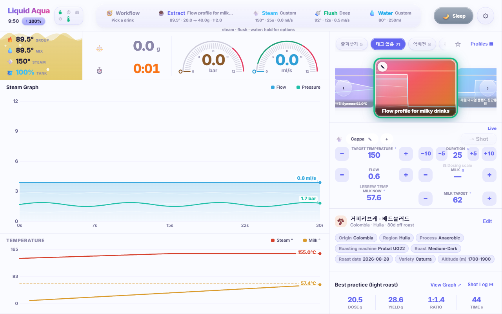
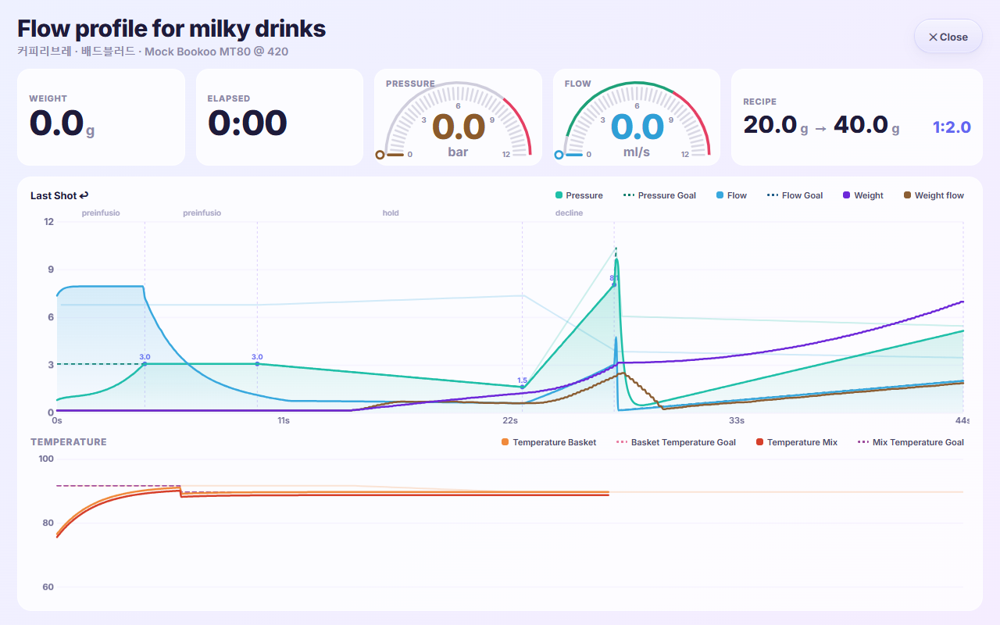
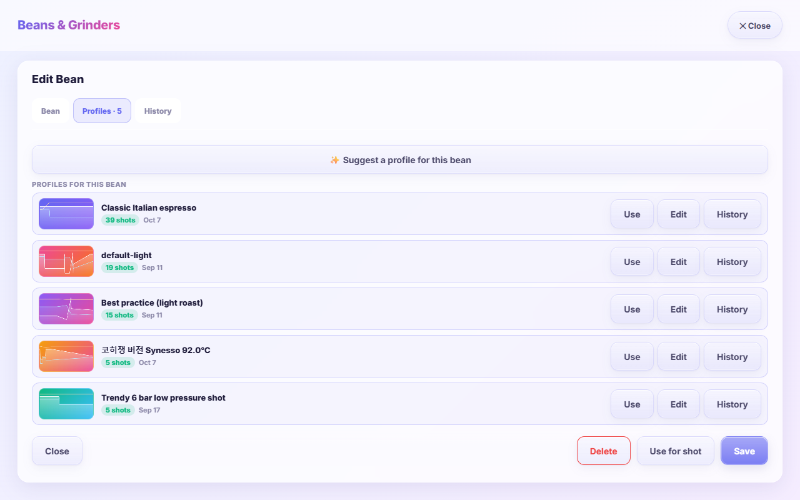
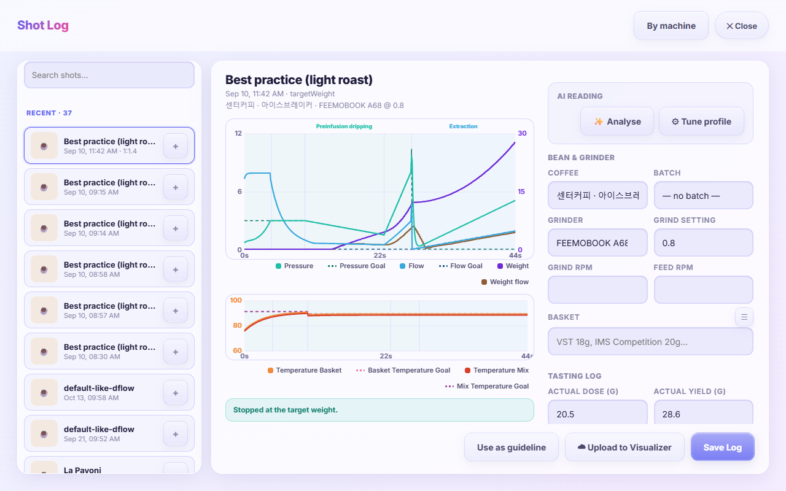
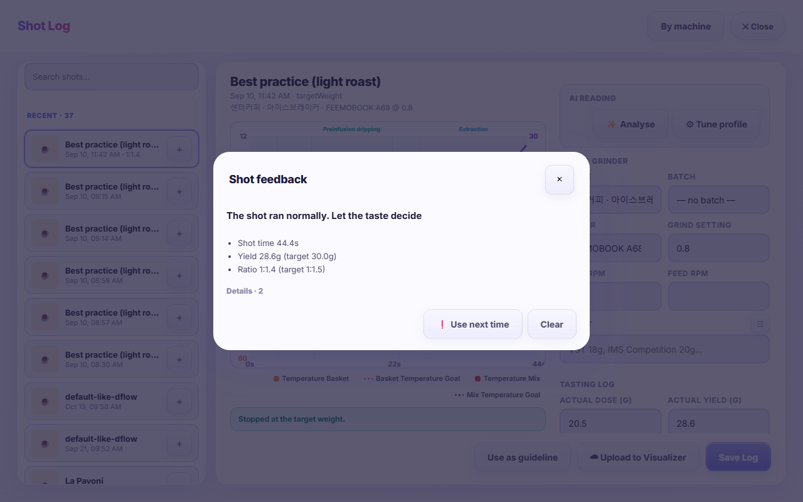
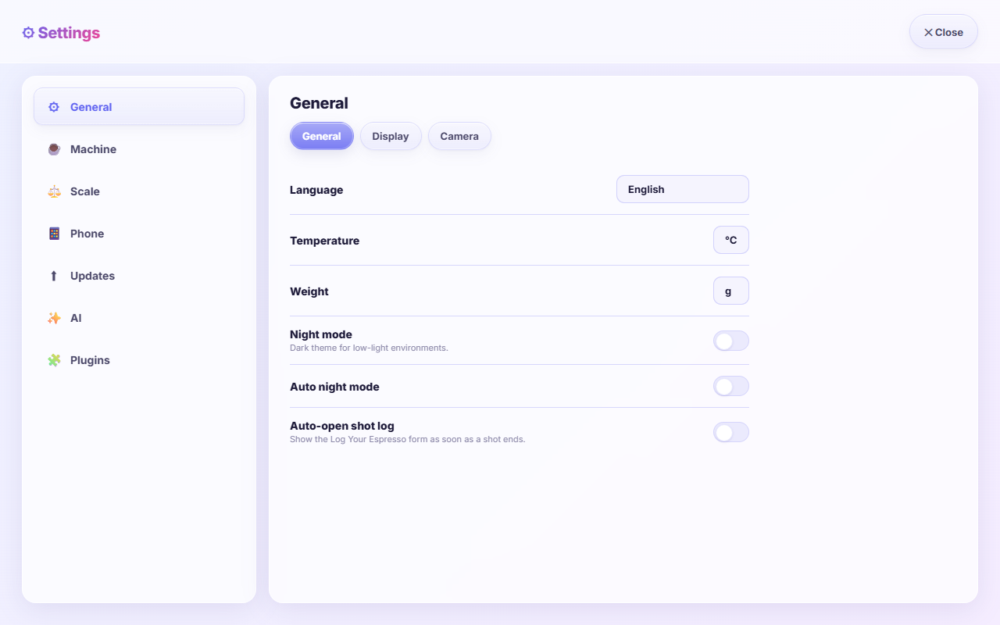
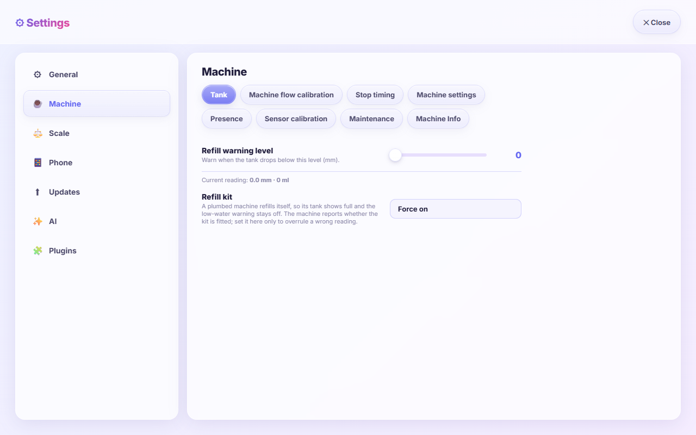
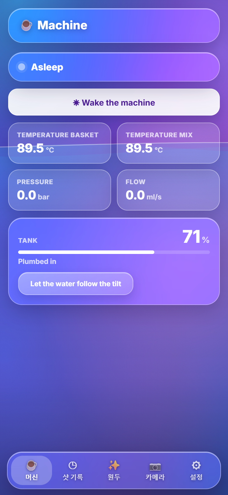
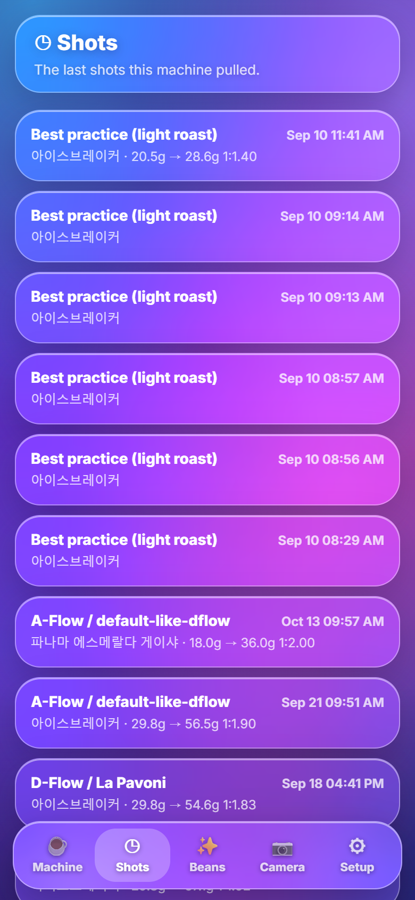

# Liquid Aqua

A bright, liquid-glass WebUI skin for [Decaid](https://github.com/decentespresso/decaid), the Decent Espresso gateway app.

**한국어 설명서: [README.ko.md](README.ko.md)**


Everything for a shot is on one screen. The top bar holds the actions, each showing its own settings. The tank, the temperatures, the scale and the dials sit across the top. The extraction and temperature graphs fill the left. The right column holds your profiles, the recipe, the coffee and the last shot. Nothing scrolls, and nothing hides behind a menu.

It is a single file. `index.html` holds the markup, the styles and the JavaScript. There is no build step and there are no dependencies. It talks to the Decaid gateway over its REST and WebSocket APIs on port `8080`. The same file also serves a [phone app](#phone).

---

## Contents

- [Requirements](#requirements)
- [Install and update](#install-and-update)
- [The main screen](#the-main-screen)
- [Workflow](#workflow)
- [Devices](#devices)
- [Steam, flush and hot water](#steam-flush-and-hot-water)
- [Monitor](#monitor)
- [Profiles](#profiles)
- [Beans and grinders](#beans-and-grinders)
- [Shot log](#shot-log)
- [Settings](#settings)
- [Sleep screen](#sleep-screen)
- [Phone](#phone)
- [Where things are stored](#where-things-are-stored)
- [Troubleshooting](#troubleshooting)
- [Development](#development)

---

## Requirements

| | |
|---|---|
| Gateway | A current Decaid with the WebUI server running |
| Display | Designed for 1280×800. Scales to fit other sizes, up to 1.6× |
| Browser | Any current browser. It is tested against Chrome, Safari and the Android WebView |
| Optional | An API key for Gemini, Claude or OpenAI. Used for the AI features: reading a bag, suggesting and tuning profiles, reading a shot, and translating the interface |

Nothing else is needed: no account, no cloud service, no telemetry. Every AI feature is optional. The shot feedback, the profile tags and the yield warnings all work without a key.

## Install and update

**Install.** Open the skin manager in Decaid and install from a GitHub release, pointing it at `SongPaul/liquid-aqua-skin`. The same can be done through the API:

```bash
curl -X POST http://<gateway>:8080/api/v1/webui/skins/install/github-release \
     -H 'Content-Type: application/json' \
     -d '{"repo":"SongPaul/liquid-aqua-skin"}'
```

Leave out `tag` to take the latest release.

**Update.** Updates are installed from the Decaid app, not from the skin. Current Decaid needs a management token for skin updates, plugin changes and turning on automatic updates, and a skin cannot create one. In the app:

1. Open **Web Interface** on the dashboard.
2. Open the menu at the top right.
3. Tap **Check for updates**.

Settings › Updates › Skin lists the release history and says when a newer version is out. From Decaid 0.9.3, on the tablet itself and with automatic updates turned on in the app, the same page also offers **Check for updates**. The same page always has **Reload**, which puts a newly installed version on screen without restarting the app; it stands out when the page can tell it is behind, and waits while the machine is running.

**For development.** Serve the folder and open it in a browser. The skin finds the gateway on its own:

```bash
python -m http.server 8081
```

---

## The main screen

### Top bar

On the left are the brand, the clock and the tablet battery. Beside them is the **device button**, with one small icon each for the machine, the scales, the grinder and, when their plugins are on, the thermometer and the bean doser. An icon turns green when that device is connected. Tap the button to open [Devices](#devices).

In the middle, each action shows the settings it will run with:

| | Shows | Tap |
|---|---|---|
| **Workflow** | the drink you are making | opens the [workflow](#workflow) |
| **Extract** | the profile, temperature, dose → yield and ratio | starts the shot |
| **Steam** | preset name, temperature, seconds, flow | starts steaming |
| **Flush** | preset name, temperature, seconds, flow | starts a flush |
| **Water** | preset name, temperature, volume | starts hot water |

Hold Steam, Flush or Water to open its options. If the machine has a GHC (the button group on the group head), the machine's own buttons start the actions instead. In that case a plain tap opens the options, and the skin notices this and labels itself to match.

On the right are **Sleep** and **⚙** [Settings](#settings). Hold **Sleep** to put the machine to sleep and leave the Decaid app: on Android it goes to the background with the machine connection still running, desktop builds quit, and iOS does not allow it, so there a hold is a plain sleep.

### Tank, scale and dials

The **tank** tile fills from the bottom with gently moving water. Its colour follows the **mix temperature**, which is the water that will actually reach the coffee: blue up to 80 °C, then one shade per degree through teal, green, yellow and orange, and red from 95 °C. Over it are the group, mix and steam temperatures and the tank level. While water is moving, bubbles rise and the waves speed up with the machine's flow, up to about two and a half times at 8 ml/s. A tank that is genuinely low turns red whatever the temperature. If a refill kit gives up, the tank says **Refill stopped** instead, so check the water supply rather than the tank. On a plumbed machine with the refill kit, the tank always reads full.

Next to it are the live **weight** and the **timer**. Tap the weight to tare.

Pressure and flow are **dials**. Their bands are read from **the loaded profile**, so the same needle means different things under different profiles. The dials switch with the action: during hot water the left one shows mix temperature, and during steam the right one shows steam flow.

| Band | |
|---|---|
| Grey | far short: the puck is not taking pressure at all |
| Amber | short: usually a grind that is too coarse |
| **Green** | **on profile**: where the profile asked to be |
| Red | over: harder than the profile ever wanted |

### Graphs

The **Extraction** graph draws pressure, flow, weight and weight flow, with the profile's goals dotted and the step names along the top. A **Temperature** graph sits below it, so a moment on one is directly above the same moment on the other. Tap a legend entry to hide or show that line.

- While steam, flush or hot water runs, both graphs switch to that action.
- **Extraction guideline** (Settings › General › Display) draws what the shot should look like under the live trace. The guideline is either the loaded profile, or a past shot you chose in the shot log.
- **View Graph** on the last-shot card puts the last shot's recording on the graph. **Back to live** returns it.
- **Tap the graph** to open the [monitor](#monitor).

### Profiles

The carousel shows your profiles as covers. Each cover draws the profile's curve. The one with the **green ring** is loaded on the machine.

- The tabs above it are **Favourites**, **No tag**, and the tags you have chosen to show on the main screen.
- **Tap the centred cover** to load it. Swipe or use the arrows to move.
- **☆** adds the profile to your favourites or removes it. **Profiles** opens the [profile list](#profiles).
- While a shot runs, the profile is locked.
- With **Camera** turned on in Settings, a camera picture takes the place of the album. Scan the code it shows with a phone to send that phone's camera, or an IP-camera app's stream.

### Recipe

Below the carousel is the recipe:

| | |
|---|---|
| **Dose** | Tap to type it. With a dosing scale it shows that scale's reading: tap to take the reading, hold to type. **⚖** zeroes the dosing scale |
| **Ratio** | Changes the yield, keeping the dose |
| **Yield** | Weighed on the brewing scale. Changing the dose carries the yield with it |
| **Grind** | Steps by your grinder's own step size. With a grinder plugin, the number is sent to the grinder |
| **Brew temperature** | The thermometer. Changing it moves the whole profile up or down. **↺** puts the profile's own temperature back |

When the loaded profile ends the shot on its own before or about at the yield (on its clock, its own volume without a scale, or a last step that ends on weight), a small line under the yield says where: amber when that is short of the yield. If the profile ran out on an earlier shot, the yield it actually poured is shown instead of the estimate. The yield is also sent as the profile's target weight, as other skins do.

### Coffee and last shot

The bean card shows the coffee in use, its days off roast and its details. **Edit** opens [Beans and grinders](#beans-and-grinders). With a [bean doser](#bean-doser) connected, the card gains an **XDOSING** tab.

The last-shot card shows that shot's profile, dose, yield, ratio and time. **Shot Log** opens the [shot log](#shot-log). When the [shot feedback](#shot-feedback) finds a yield or time that is off, that number turns amber with a small arrow (short or long). Channelling, a grind that reads coarse or fine, and a temperature that was off are named in a small tag beside the profile; tapping it opens the shot log.

---

## Workflow


**Workflow** in the top bar sets up a drink step by step: **Espresso**, **Americano** (an espresso, then hot water) or **Latte** (an espresso, then steamed milk).

The rail across the top shows the steps: bean, profile, grind, recipe, and then water or milk. Each step offers what you used recently first. When it is done, everything is already set on the machine. Start the shot from **Extract** or from the group head. The workflow only prepares the drink; it never starts the machine.

---

## Devices


Tap the device button in the top bar. Each kind of device has its own cell, side by side, with what is connected now at the top and what else is **in reach** below it. An empty cell says so in its head and takes no more room. The brewing scale is not offered as the dosing scale, nor the other way round:

| Cell | |
|---|---|
| Machine | the DE1 |
| Brewing scale | the scale a shot is weighed on. The gateway reconnects to it by itself |
| Dosing scale | a second scale to weigh the dose on. It is held for this skin only, never weighs a shot, and is let go when the app closes |
| Grinder | a grinder driven by a plugin |
| Thermometer | appears when a thermometer plugin is on |
| Bean doser | appears when the RedxKey doser plugin is on |

**Find** (next to the close button) looks again without connecting anything. The gateway stops looking once it has a scale, so a scale switched on later is only noticed this way. Devices in reach stay listed while it looks.

The skin never scans by itself, as other skins do not: a scan shares the Bluetooth radio with everything already connected. A dosing scale that is away is looked for when you tap it on the recipe card. What the skin connects by itself waits its turn: the machine first, then the brewing scale, each left to settle, and only then the dosing scale.

---

## Steam, flush and hot water

Tap an action in the top bar to run it, or hold it for its options. Each has up to three named presets. **Save the current numbers as a preset** stores what is on screen.

**While the action runs**, the recipe card turns into live controls for that action's numbers. Changes take effect as you tap, and the skin batches your taps into one write.

| | |
|---|---|
| Steam | temperature, seconds, flow |
| Flush | temperature, seconds, flow |
| Hot water | temperature, volume, seconds, flow |

The machine is given the volume as set, the way Streamline gives it. With a scale connected, the gateway stops hot water when the cup reaches that weight; without one the machine stops on its own estimate of the volume. The **Hot water** tab in Settings › Machine has, as in Streamline, the flow, the switch for the scale stop and how early it stops so that the cup lands on the target. Streamline's time limit is not offered: the machine ignores it whenever a volume is set ([decaid #1128](https://github.com/decentespresso/decaid/issues/1128)).

Some machines stop hot water on their own pump count well before the cup reaches the amount, so the gateway's scale stop never gets the chance ([decaid #1119](https://github.com/decentespresso/decaid/issues/1119)). So **Stop on the scale in this skin** is on by default (a switch in the same tab turns it off): with a scale the machine is asked for half again (up to 250 ml) and the skin stops the pour when the cup reaches the amount, as de1app does. A pour started at the group head while the skin is not running can then give up to half again.

### Milk thermometer



With a thermometer plugin turned on, such as [LEBREW TEMP](https://github.com/SongPaul/lebrew-temp-plugin), the steam card gains two blocks:

- **Milk now**: the thermometer's reading, green once it reaches the target.
- **Milk target**: the temperature steaming stops at, from 30 to 90 °C, or *off*. It is saved as the workflow's `steamSettings.stopAtTemperature`, and the gateway stops the steam there. The skin does not send a stop of its own, because a second stop would count as the second tap of the two-tap steam purge and purge straight away.

While steaming, the temperature graph draws the milk in orange with its live reading, and the milk target as a dashed line. Tap **Milk °** in the legend to hide or show it.

With a dosing scale, the steam card also weighs the milk. **→ Shot** records that weight in the last shot's notes.

### Bean doser


With the RedxKey bean doser plugin (`redxkey.reaplugin`) turned on, the device sheet gains a **Bean doser** cell. Up to four modules can be connected at once, which is the gateway's limit for one plugin. With a module connected, the bean card has two tabs: **Bean** and **XDOSING**, which shows how many modules are connected.

- XDOSING lists every connected module on one line: its number, its bean, its grams, **Dispense** and **Use**. **Dispense all · N g** sits beside the tabs.
- Each module can be given a bean from the bean list. The bean and grams are kept on this tablet under the module's name.
- Grams run from 0 to 25.5 g in 0.1 g steps. A single module with nothing kept starts at the recipe dose.
- A module that pours makes its bean the recipe's bean, so the next shot is saved with it. **Dispense all** takes the bean of the module that poured the most. **Use** does the same without pouring.
- A module's number turns green once it has poured, and amber if it failed or may have poured. A dispense that failed after the start byte was sent may still have poured, so the next dispense on that module asks first.

---

## Monitor



One action at full screen: the graphs worth watching and the numbers worth reading from across the room. It opens itself when an action starts. Settings › General › Display chooses which actions open it, and which close it again when they finish. Tapping the graph opens it at any time.

| | |
|---|---|
| Heading | for a shot, the profile with the bean, grinder and grind beneath. For steam, flush and water, the action itself |
| Weight · Elapsed | large enough to read at a distance |
| The two dials | the same bands as the main screen |
| Recipe | dose → yield and ratio for a shot, or the action's own settings |
| Graphs | Extraction above, Temperature below, on the same time axis |

**Close puts the page away; it does not stop the machine.** While an action runs, the monitor carries its own **Stop**. That Stop is hidden when a GHC is fitted, because the group head owns starting and stopping there. The monitor stays up after the action ends until you close it, so the result can still be read.

---

## Profiles


**Profiles** on the main screen opens the list. Every profile is a card with its curve, peak, temperature and expected time.

- **Search** by name or notes. Filter by **Espresso / Brew · tea / Clean · manual / All**, **Hidden**, or the **Bin**.
- Profiles are grouped into **Favourites** and **Recently used**, followed by the rest.
- **Tags** come from each profile's own shape (pressure, flow, mixed, low pressure, bloom, declining, hot, cool), plus any roast level you set. Filled tags are the ones the main screen offers as tabs; hold a tag to change that. **Tags** at the top renames, deletes and picks tags across every profile.
- **✨ Classify with AI** reads the whole catalogue once and tags each profile with a roast level.
- **+ New profile** starts one. **Add** imports profiles from Visualizer (a share code, a shot link, or by browsing the community) or from `.tcl` and `.json` files, including a whole folder at once.
- **Edit list** selects several profiles to hide, show or delete together. A deleted profile goes to the Bin, where it can be put back. A profile that ships with the app is hidden rather than deleted.

### The editor


At the top are the title, the **card colour**, the **roast level**, the notes, tags, kind, author and the weight to stop at. **More** opens the remaining fields the profile carries.

- The **curve** shows pressure, flow and temperature for every step. Press a stretch of the curve to edit the step that drew it.
- The **step table** lists every step with its target, temperature, seconds, volume, weight and exit condition. Drag a step to reorder it, or use the buttons to move, duplicate and delete.
- The **step panel** on the right edits one step: pressure or flow, the temperature and where it is measured (basket or water), the ramp (step or ease), the limiter, seconds, the volume and weight limits, and the exit condition.
- **Tune profile** sends the shots pulled on this profile to the AI. It adjusts only the values of the steps the profile already has; no step is added, removed or renamed. Save the result as a copy, or over the profile.
- **Use for shot** loads what is on screen, so unsaved edits are what the machine gets. **Save Profile** stores it.

---

## Beans and grinders


Open it from **Edit** on the bean card, or by holding the grinder name in the recipe. Beans and grinders are cards: **tap to use one**, and hold or use the pencil to edit.

- A bean's card shows its bag photo, its days off roast and how far past roast it is (**Resting**, **Ready**, **Fading**, **Past peak**, or **Frozen**).
- Filter by **All / Ready / Frozen / Used up**, and order by **Suggested**, roast date or name. **Select** acts on several beans at once: put them away, bring them back, or delete.

### A bean


A coffee is one bean. Each time you buy it again is a **batch**, with its own roast date, roast level and bag weight. The bean carries what does not change: roaster, name, roasting machine and its heat transfer, origin, region, producer, processing, variety, altitude, species and decaf. A **blend** lists its coffees with their shares.

- **Freeze** and **Used up** mark the batch. With a bag weight, the card counts the shots and estimates what is left.
- **✨ Scan label with AI** fills the form from photos of the bag (up to five). **Camera** and **Attach** work on the tablet. **Use phone** shows a QR code: photograph the bag on the phone, and the result is saved straight to the gateway. The scan keeps what the bag says, in the bag's language. What it found by searching rather than on the bag is marked for checking. Scanning a coffee you already have offers to add a **new batch** rather than a duplicate bean.
- Up to three bag photos are kept with the bean. They become its cover and fill the [sleep screen](#sleep-screen).
- **Use for shot** puts the bean in the workflow, so every shot records what it was pulled with.

### Profiles for this bean



One list, whatever the source. Each row shows the profile's curve, how many shots you pulled with it on this bean, and when. **Use** loads it, **Edit** opens it in the editor, and **History** shows only the shots pulled with it.

**✨ Suggest a profile for this bean** asks the AI which of *your installed* profiles suits this coffee, and ranks five. The answer is saved with the bean, so reopening it costs no API call.

### This bean so far


The shot history for this coffee: average dose, yield, ratio, grind and rating, the number of shots and their date range, and the latest 20 shots. Tap one to open it in the shot log.

### Grinders


A grinder is a **brand** and a **model**, a grind setting, an optional speed, and its burrs.

- The setting is either a **numeric dial** with your own fine and coarse step, or a list of **named presets**.
- **Burrs** are the burr brand, type, size, coating and geometry, with a note on what they do.
- **Auto-fill grinder** looks the grinder up by brand and model and fills only the empty fields. It is told never to guess a burr size: a grinder it does not recognise comes back empty rather than plausible.
- A grinder driven by a plugin (Bookoo MT80, xBloom, Eureka E64 and others) is added by itself and marked **Linked**. Its name and dial follow the plugin, and the recipe card sets it while it is in use. Settings › Plugins installs grinder plugins.

The AI shot reading and the profile suggestions are both given the grinder, so a grind change is suggested in terms of *your* dial.

---

## Shot log



Every recorded shot, newest first. **★ 4+** beside the search shows only the shots you rated four stars or more, among the latest 200. Pick one to see the recording on the left and the record on the right.

**On the left:** the extraction and temperature graphs as they actually happened, with the steps named along the top, and why the shot ended ("Stopped at the target weight").

**On the right:**

| | |
|---|---|
| AI reading | **Analyse** and **Tune profile** |
| Bean & grinder | the coffee, batch, grinder, grind and speeds the shot was recorded with. Correct them here if the wrong bean was loaded |
| Basket | from your own basket list |
| Tasting log | actual dose and yield, TDS, extraction yield, and a tasting card: acidity, bitterness, sweetness, body, dry finish, aftertaste, and whether you would have another |

At the bottom: **Use as guideline** draws this shot under the live graph. **Upload to Visualizer** sends the shot, or updates it if it is already there. **Save Log** writes it to the gateway.

**By machine** groups your shots by the roaster's machine, its heat transfer and batch size. It is a record of what you dialled in, not a verdict on the machine.

### Comparing shots


Every row has a **+** on its right. Press it to add the shot to a comparison, where it takes a colour. Up to four shots can be compared.

With two or more picked, the detail becomes an overlay: one measurement across every shot on a shared axis. **Pressure / Flow / Weight / Weight flow / Group** picks the measurement, and **All** draws every one at once with dash patterns. Below is a table of dose, yield, ratio, time, peak pressure, group temperature, grind, TDS, EY and rating, one column per shot. **Clear** returns to the single shot.

### Shot feedback



When a shot ends, its pressure, flow and weight are checked right here, with no AI and no network. The last-shot card marks what is off on its numbers, and the shot log shows the full reading for any shot with a recorded curve:

- a verdict: ran normally, ran fast (grind coarse), choked (grind fine), channelled, or mixed signs;
- the shot time, yield and ratio against their targets, puck resistance and extraction yield;
- if the profile ran out before the target weight, how many seconds the last step needs, or the yield to set instead.

**Use next time** in the shot log keeps the suggestion and shows it on the card the next time that profile is loaded. Settings › General › Display turns the feedback on or off.

With a scale, the skin also learns **when to stop**. After each shot it compares the settled weight with the target and moves the stop a little earlier or later. A toast says what it changed, and **Undo** puts it back. Settings › Machine › Stop timing turns this off.

### AI reading

**Analyse** sends the shot to the AI and asks what the curve did. The AI gets the profile, the bean and grinder, the measured figures, your tasting notes and the curve itself, downsampled to about two dozen points. It answers with a verdict, a few observations and up to three changes, each with its reason. It works on a comparison too: what actually differs between these shots, and which one to chase.

- Readings are cached against the shots they were made from, so reopening a shot costs no call.
- Mark a suggestion **Worked** or **Did not**. Those reactions go with the next reading, so it stops repeating what did not work. Settings › AI shows what is remembered and can forget it.

---

## Settings



Settings is a list of categories, each with its own tabs.

| Category | Tabs and what is in them |
|---|---|
| **General** | **General**: language, °C/°F, g/oz, night mode and auto night mode, auto-open the shot log, a way back to the Decaid dashboard. **Display**: brightness, keep the screen awake, low-battery dimming, the extraction guideline, which actions open and close the monitor, the shot feedback, screen effects, the frame meter, and the sleep screen's photos, motion and dimming. **Camera**: the camera in the album, and how to turn, fill, enlarge and mirror it |
| **Machine** | Four tabs. **Tank** (refill warning, refill kit); **Flow & stop** (stop timing with the learned shot stop, hot water: flow, scale stop, stopping in the skin, and the machine flow calibration); **Machine settings** (USB charger, fan, tank heater, steam purge, sleep after inactivity); **Care & info** (clean, descale, air purge, machine info, sensor calibration read only) |
| **Scale** | refuse to start without a scale, room to reach the target, and what to do with the scale when the machine sleeps |
| **Phone** | the address and QR code for the [phone app](#phone) |
| **Updates** | **Firmware** (update, or upload a file), **App update** for Decaid, **Skin** release history |
| **AI** | the provider (Gemini, Claude or OpenAI) and its key, with a key check. **What the reader remembers** |
| **Plugins** | installed plugins, and grinder plugins with their GitHub addresses. From Decaid 0.9.2, plugins are installed, switched and configured in the Decaid app, and this page says so instead of offering switches that would be refused |



- **Language** offers English and Korean built in, plus thirteen more languages that are translated once with your AI key and kept.
- **Room to reach the target**: when a profile would end on its clock before the target weight, its last step is held up to 20 seconds longer. The shot still stops at the target. The stored profile is not changed.
- **Machine flow calibration**: the DE1 estimates flow from its pump, and this multiplier scales that estimate for espresso as well as hot water. The value is typed on the skin's keypad or stepped by 0.01, written to the machine and read back. It is not worked out from a hot water pour: the machine's hot water error changes with flow, so one pour does not give a calibration ([decaid #1128](https://github.com/decentespresso/decaid/issues/1128)). The last value read is shown at once and refreshed behind it.
- **Screen effects** turns off the moving water, the curved graph's motion, the sheen across a cover, the touch ripple and the glass blur on the other pages, for a tablet that stutters. The **frame meter** shows frames per second; tap it for a log of slow frames and what ran around them.

---

## Sleep screen


Sleep from the top bar, or let the machine sleep on its own; the skin follows either way. It shows a clock, the date and the battery over a wall of your bag photos. Until there are enough photos, drawn bags make up the numbers. Settings › Display sets whether the wall moves always, in bursts or not at all.

It is built to cost as close to nothing as a screen can:

- the wake lock is released, so the tablet's own display timeout applies;
- the interface behind it stops painting, and every animation stops;
- brightness drops to your sleep level and comes back on wake;
- the sockets with nothing to say while asleep are closed and reopened on wake. Only the machine's state stays open, so a machine woken at the group head is noticed.

The full-screen pages (beans, profiles, the shot log, settings) do the same while they are open: the screen behind them stops painting.

---

## Phone

<p>


</p>

Open the address from Settings › Phone on a phone and the skin shows its phone app. Add it to the home screen and it opens like an app. Its tabs are:

| | |
|---|---|
| **Machine** | state, temperatures, pressure, flow and tank, with wake and sleep |
| **Shots** | the last shots, with their graph, tasting notes and upload to Visualizer. When the machine is out of reach, it reads your shots from Visualizer instead |
| **Beans** | photograph a bag and add it, or update a bean's batch |
| **Camera** | send this phone's camera to the album on the tablet |
| **Setup** | the phone's own settings, the AI key, and a Visualizer account |

---

## Where things are stored

**On the gateway**, so every device sees the same thing: the workflow (profile, dose, yield, grinder, coffee), the steam, flush and hot-water settings, beans and batches, grinders, and shots with their tasting notes. A profile's colour, tags and roast level go in its `metadata`, and a bean's saved suggestions and photos in its `extras`.

**The skin's own data** lives in the gateway's key-value store, under the namespace `liquid-aqua`, and the browser keeps a copy. The skin keeps one browser origin across updates, but the phone, another address for the tablet, or a run where Decaid has to fall back to a temporary port each start with an empty `localStorage`. The store is the same for all of them; the local copy makes the skin start instantly and keeps it working when the gateway cannot be reached.

| Key | |
|---|---|
| `prefs` | language, units, night mode, display, monitor and sleep options, AI provider and key |
| `favs` | favourite profiles |
| `presets` | steam, flush and water presets |
| `shotai`, `aifb`, `aipin` | AI readings, your reactions to them, and a suggestion kept for next time |
| `shotread`, `ranout` | the last shot feedback, and profiles that ran out before the target |
| `grindmem`, `gspeed`, `gfeed`, `gburr`, `gbrands` | grind settings per bean, grinder speeds, burrs and brands |
| `baskets`, `rmachines`, `beanfav`, `wfhist` | your basket list, the roasting-machine list, favourite beans, recent workflow choices |
| `i18n` | languages translated with AI |

In the browser the same keys are kept with an `aurora_` prefix.

---

## Troubleshooting

**There is no update button.** On Decaid 0.9.2 skin updates are installed from the Decaid app: Web Interface on the dashboard, then the menu at the top right, then Check for updates. From 0.9.3 the button comes back on the tablet when automatic updates are on.

**The tank is red and the water is not hot.** The tank is at or below the refill level. On a plumbed machine, set *Refill kit* in Settings › Machine › Tank.

**AI buttons do nothing, or take me to Settings.** There is no key for the chosen provider. Settings › AI, then **Check the key**.

**The yield has an amber !.** The loaded profile will probably end before that weight. Tap it to match the yield, or give the profile more room in the editor.

**A second scale is not found.** Turn it on, then **Find** in Devices. The gateway stops looking once it has one scale.

**The phone QR opens a page that cannot reach the gateway.** The gateway is reporting an address the phone cannot see. Type the tablet's Wi-Fi address in Settings › Phone.

**The screen stutters.** Turn off *Screen effects* in Settings › General › Display. The frame meter there shows how smoothly the tablet runs.

**Everything is tiny or clipped.** The skin lays out at 1280×800 and scales to fit. Very narrow windows letterbox rather than reflow, except on a phone, which gets the phone app.

---

## Development

```
index.html             the entire skin
skin-manifest.json     id, name, description, version
sw.js                  the service worker that caches the skin
de1-translations.csv   Decent's official translations, used to seed AI translation
inter-*.woff2          the interface font, so nothing is fetched from the internet
sample-bags.json       drawn bags for the sleep screen
docs/                  screenshots for this README
tools/test/            headless browser tests
```

No build and no package manager: edit `index.html` and reload. `python tools/test/run.py` runs the browser tests against a gateway on `127.0.0.1:8080`. The tests never write to the gateway; see [tools/test/README.md](tools/test/README.md).

Conventions that keep it coherent:

- Every control is at least 40 px on its shortest side, and nothing renders below 11 px.
- One gradient-filled control per view, for the primary action. Everything else that carries the accent colour is tinted, not filled.
- Values are the content and buttons are chrome: the number is larger than the buttons around it.
- Layout is a fixed 1280×800 stage. If something new does not fit, something else gives up height on purpose.

## License

MIT
