# Liquid Aqua

A bright, liquid-glass WebUI skin for [Decaid](https://github.com/decentespresso/decaid), the Decent Espresso gateway app.

**한국어 설명서: [README.ko.md](README.ko.md)**

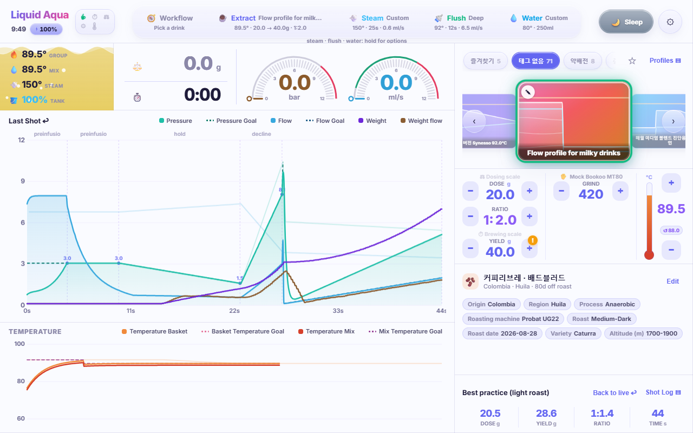

Everything for a shot is on one screen. The top bar holds the actions, each showing its own settings. The tank, the temperatures, the scale and the dials sit across the top. The extraction and temperature graphs fill the left. The right column holds your profiles, the recipe, the coffee and the last shot. Nothing scrolls, and nothing hides behind a menu.

It is a single file. `index.html` holds the markup, the styles and the JavaScript. There is no build step and there are no dependencies. It talks to the Decaid gateway over its REST and WebSocket APIs on port `8080`. The same file also serves a [phone app](#phone).

---

## Contents

- [Requirements](#requirements)
- [Install and update](#install-and-update)
- [The main screen](#the-main-screen)
- [Workflow](#workflow)
- [Devices](#devices)
- [Steam, flush and hot water](#steam-flush-and-hot-water)
- [Monitor](#monitor)
- [Profiles](#profiles)
- [Beans and grinders](#beans-and-grinders)
- [Shot log](#shot-log)
- [Settings](#settings)
- [Sleep screen](#sleep-screen)
- [Phone](#phone)
- [Where things are stored](#where-things-are-stored)
- [Troubleshooting](#troubleshooting)
- [Development](#development)

---

## Requirements

| | |
|---|---|
| Gateway | A current Decaid with the WebUI server running |
| Display | Designed for 1280×800. Scales to fit other sizes, up to 1.6× |
| Browser | Any current browser. It is tested against Chrome, Safari and the Android WebView |
| Optional | An API key for Gemini, Claude or OpenAI. Used for the AI features: reading a bag, suggesting and tuning profiles, reading a shot, and translating the interface |

Nothing else is needed: no account, no cloud service, no telemetry. Every AI feature is optional. The shot feedback, the profile tags and the yield warnings all work without a key.

## Install and update

**Install.** Open the skin manager in Decaid and install from a GitHub release, pointing it at `SongPaul/liquid-aqua-skin`. The same can be done through the API:

```bash
curl -X POST http://<gateway>:8080/api/v1/webui/skins/install/github-release \
     -H 'Content-Type: application/json' \
     -d '{"repo":"SongPaul/liquid-aqua-skin"}'
```

Leave out `tag` to take the latest release.

**Update.** From Decaid 0.9.3 the skin can update itself: Settings › Updates › Skin › **Check for updates**. Decaid 0.9.2, and 0.9.3 with **Require authorization for extension management** turned on in its Security settings, needs a management token for skin updates and plugin changes, and a skin cannot create one; then the update is done in the app:

1. Open **Web Interface** on the dashboard.
2. Open the menu at the top right.
3. Tap **Check for updates**.

Settings › Updates › Skin lists the release history and says when a newer version is out. From Decaid 0.9.3 the same page also offers **Check for updates**, until the gateway refuses it for want of a token. The same page always has **Reload**, which puts a newly installed version on screen without restarting the app; it stands out when the page can tell it is behind, and waits while the machine is running.

**For development.** Serve the folder and open it in a browser. The skin finds the gateway on its own:

```bash
python -m http.server 8081
```

---

## The main screen

### Top bar

On the left are the clock and the tablet battery. **What the machine is doing** is said at the top of the tank panel below, as a large word in the state's colour with the figure that goes with it on the right:

| State | When |
|---|---|
| **Ready** | idle and at temperature |
| **Heating** | the machine reports it is heating (one of its heating states, or idle while its heaters come up). The figure beside it reads the group against where it is going, e.g. **71° → 93°**; without a target from the machine, the recipe's temperature stands in |
| **Brewing**, **Steam**, **Hot water**, **Flush** | that action is running. While a shot runs, the figure is the profile step being poured (**preinfusion**); for steam, hot water and flush it is how long it has run (**0:07**), which is not read out every second |
| **Low water** | the machine stopped for water (red) |
| **Asleep** | the machine is asleep |
| **No machine** | the machine is not connected (red) |
| **Busy**, **Error** | cleaning, descaling and the like, or a machine error |

The word is green when ready, amber while heating, purple while an action runs, grey asleep and red when something needs you. Nothing in it blinks. Under it the panel reads the group and mix, then the steam and the tank, as two pairs; out of water, only the tank's value turns red. The water's colour and height follow the temperature and the tank. While a shot runs, bubbles rise in a narrow strip at the panel's right edge, away from the words; steam lifts three slow wisps. With effects off or reduced motion asked for by the tablet, there is no motion at all. With no machine, the panel says so, with dashes and no water.

Beside it is the **device button**: a line drawing for the machine, the brewing scale, the dosing scale, the grinder and, when their plugins are on, the thermometer and the bean doser. The dot on each is green when connected, amber while connecting or when connected but not in use, and an empty ring when off. Tap the button to open [Devices](#devices).

In the middle, each action shows the settings it will run with:

| | Shows | Tap |
|---|---|---|
| **Workflow** | the drink you are making | opens the [workflow](#workflow) |
| **Extract** | dose → yield | starts the shot |
| **Steam** | temperature and seconds | starts steaming |
| **Flush** | temperature and seconds | starts a flush |
| **Water** | temperature and volume | starts hot water |

Hold Steam, Flush or Water to open its options. If the machine has a GHC (the button group on the group head), the machine's own buttons start the actions instead, and a plain tap opens the options.

On the right are **Sleep** and **⚙** [Settings](#settings). Hold **Sleep** to put the machine to sleep and leave the Decaid app: on Android it goes to the background with the machine connection still running, desktop builds quit, and iOS does not allow it, so there a hold is a plain sleep.

### Tank, scale and dials

The **tank** tile fills from the bottom with gently moving water. Its colour follows the **mix temperature**, which is the water that will actually reach the coffee: blue up to 80 °C, then one shade per degree through teal, green, yellow and orange, and red from 95 °C. Over it are the group, mix and steam temperatures and the tank level. While water is moving, bubbles rise and the waves speed up with the machine's flow, up to about two and a half times at 8 ml/s. A tank that is genuinely low turns red whatever the temperature. If a refill kit gives up, the tank says **Refill stopped** instead, so check the water supply rather than the tank. On a plumbed machine with the refill kit, the tank always reads full.

Next to it are the live **weight** and the **timer**. The brewing scale is named over the weight with its dot; tap the weight to tare. A scale that is set up but not connected shows a dash with an empty dot, and a tap opens [Devices](#devices) instead; if it drops out mid shot, its name line says **Will not stop on weight**. With no scale at all the block says **No scale** with a **Connect** button.

Pressure and flow are **dials**. Their bands are read from **the loaded profile**, so the same needle means different things under different profiles. The dials switch with the action: during hot water the left one shows mix temperature, and during steam the right one shows steam flow.

| Band | |
|---|---|
| Grey | far short: the puck is not taking pressure at all |
| Amber | short: usually a grind that is too coarse |
| **Green** | **on profile**: where the profile asked to be |
| Red | over: harder than the profile ever wanted |

### Graphs

The **Extraction** graph draws pressure, flow, weight and weight flow, with the profile's goals dotted and the step names along the top. A **Temperature** graph sits below it, so a moment on one is directly above the same moment on the other. Tap a legend entry to hide or show that line.

- While steam, flush or hot water runs, both graphs switch to that action.
- **Extraction guideline** (Settings › General › Display) draws what the shot should look like under the live trace. The guideline is either the loaded profile, or a past shot you chose in the shot log.
- **View Graph** on the last-shot card puts the last shot's recording on the graph. **Back to live** returns it.
- **Tap the graph** to open the [monitor](#monitor).

### Profiles

The carousel shows your profiles as covers. Each cover draws the profile's curve. The one with the **green ring** is loaded on the machine.

- The tabs above it are **Favourites**, **No tag**, and the tags you have chosen to show on the main screen.
- **Tap the centred cover** to load it. Swipe or use the arrows to move. Only the centred cover carries its name.
- **☆** adds the profile to your favourites or removes it. **Profiles** opens the [profile list](#profiles).
- While a shot runs, the profile is locked.
- With **Camera** turned on in Settings, a camera picture takes the place of the album. Scan the code it shows with a phone to send that phone's camera, or an IP-camera app's stream.

### Recipe

Below the carousel is the recipe: **Dose**, **Ratio** and **Yield** on one row, and under them the **Temperature** beside what the profile says. Each value is a 36 by 44 minus, the caption over the number, and a plus; tap the number to type it. The ratio's 1: is drawn as a unit. Things that are only said, not set, are a borderless caption over a value. There are no chips on the card.

- **Dose**: tap to take the dosing scale's reading, hold to type. Without a dosing scale, tap to type and hold to take the brewing scale's reading. The ratio changes the yield, keeping the dose, and runs from 1:1 to 1:5; the yield is weighed on the brewing scale, and changing the dose carries it along. The yield has no range of its own: it is held only to at least the dose and to 200 g, so 30 g at 1:5 (150 g) is fine. The dose has no range of its own: it is only held between 1 and 60 g.
- **The take bar** runs across the card between the rows, only while there is a reading worth taking: received in the last 10 s, still for about a second and at least 0.5 g. It says what a press does: **⤓ Acaia Lunar 18.3 g into the dose** (the dosing scale when one is set, otherwise the brewing scale). A press puts the reading in the dose, with **Undo** in the message, and the bar goes, since the dose now is the reading; it comes back when the reading moves by more than 0.2 g or the dose is changed. A set dosing scale is the only source: if it drops out, the brewing scale does not stand in. Otherwise there is no bar and the card is a row shorter: a reading still settling greys the dose with an amber dot, and the dose's title says so. Amber means only that: the number is still moving. An empty scale, a scale gone quiet or a dosing scale not connected show nothing. There is no bar during a shot or with no scale at all. The dose keypad offers the reading as a button on the same terms, shown with the amber dot and not yet pressable while it settles; there it fills the number and **Set** takes it.
- **Temperature** reads the profile's first step. Changing it moves the whole profile by the same amount, so a profile that runs 94 → 90 → 88 brews 92 → 88 → 86 when set to 92; a step with no temperature of its own takes the card's. The number is kept per profile and the profile itself is not rewritten. When it differs from the profile, **Profile 88.0** is said beside it (its place is kept empty otherwise, so nothing beside it moves), and the temperature keypad offers **Profile 88.0** as a button that puts the profile's own temperatures back.
- **What stops the shot** is the brewing scale at the yield, and that goes without saying. When the loaded profile ends the shot on its own before or about at the yield (on its clock, its own volume without a scale, or a last step that ends on weight), it is said on the temperature's row: **Profile ends / about 36.0 g**, or **Profile stops / 36.0 ml** without a scale. The value is amber when it is short of the yield. If the profile ran out on an earlier shot, the yield it actually poured is shown instead of the estimate.

The yield is also sent as the profile's target weight, as other skins do.

**While a shot runs the card is locked except the yield.** Dose, ratio, temperature and the grinder card are already in the cup, so they dim and a press on one says why instead of changing it; the card cannot switch to steam, flush or water by hand either. The yield stays live, since the scale stops the shot on it; the cup's weight is on the stage. The take bar goes away for the shot. The lock lifts when the shot ends.

#### Grinder card

The grinder has a card of its own between the recipe and the bean card, shown whenever a grinder is in use. A grinder used by hand is its name beside its **Grind**, stepped by your grinder's own step size; tap the name for the grinders. A grinder driven by a plugin that is connected and in use has a head line with its dot, its name and what it reads (**Bookoo MT80 · reads 418**); tap the name for the grinder's own panel (the MT80) or the grinders, hold it for the grinders. Under the head, **Grind**, **RPM** and, for the MT80, **Feed** each have a minus and a plus that step by what the grinder declares; a control the grinder does not declare is not shown. A linked grinder that does not take the grind setting is dialled by hand: its **Grind** has no minus or plus, and a tap types what was dialled for the shot to record, while its speeds keep theirs. A grinder that only reports also shows what it reads, with nothing to press. Grinders are changed from the device menu, not from the card. A grinder's editor has **Grind dialled by hand**: on, the card records the grind without buttons and sends nothing to the grinder for it, even when its plugin could set it (the MT80's gap is turned on the grinder); its speeds still go to it.

A grind is a number on one grinder's dial: the MT80 counts its gap in **µm**, a Niche counts steps. So the grind is remembered per bean and grinder, and picking a grinder brings back its own: the last grind used with it for this bean, else for any bean, else what its record holds, else nothing. The other grinder's number is never carried across. The MT80's unit goes with its grind on the keypad, in the grinder's head line and in the shot records; the grind cells on the grinder card and the phone's recipe show the number alone, never cut short, a long one set a step smaller. **Last shot's settings** offers a grind together with the grinder it was set on.

### Coffee and last shot

The bean card shows the coffee in use with the same rest badge as the bean page (**D+12 · Ready**; a frozen bag counts its days out of the freezer and says **Frozen**), its origin, and four facts: process, roast, roasting machine and roast date. **Change bean** opens [Beans and grinders](#beans-and-grinders). With no bean in use the card says so and offers **Pick a bean**. With a [bean doser](#bean-doser) connected, the card gains an **XDOSING** tab.

The right column is as tall as the screen, so the take bar, the grinder card and the XDOSING tabs are paid for by the bean card. It gives up whole lines, never half of one: the facts go a row at a time, the second row first, so no more than a row's worth of room is left empty, and the name and the line with the rest badge and origin stay. With XDOSING the bean tab is the name and that line alone, with **Change bean** on the tab row.

The last-shot card shows that shot's profile, dose, yield, ratio and time, each with its unit beside it. **Shot Log** opens the [shot log](#shot-log). When the [shot feedback](#shot-feedback) finds a yield or time that is off, that number turns amber with a small arrow (short or long). Channelling, a grind that reads coarse or fine, and a temperature that was off are named in a small tag beside the profile; tapping it opens the shot log.

---

## Workflow

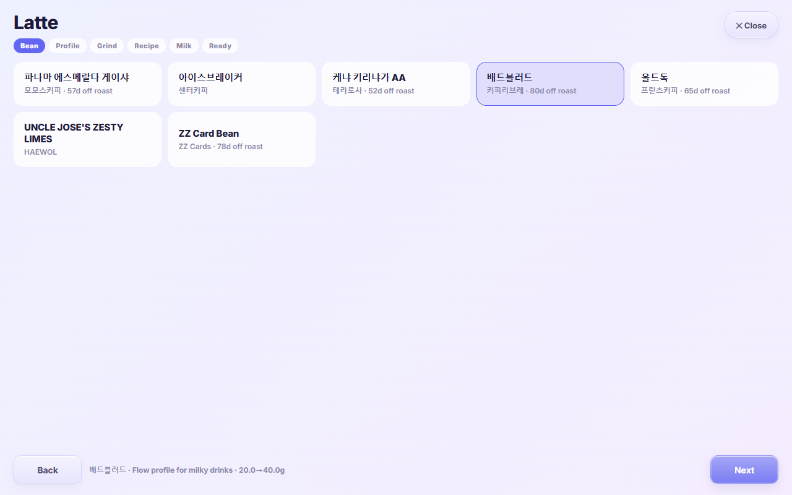

**Workflow** in the top bar sets up a drink step by step, starting from three large cards in the middle of the page: **Espresso**, **Americano** (an espresso, then hot water) or **Latte** (an espresso, then steamed milk).

The rail across the top shows the steps: bean, profile, grind, recipe, and then water or milk. Each step offers what you used recently first. When it is done, everything is already set on the machine. Start the shot from **Extract** or from the group head. The workflow only prepares the drink; it never starts the machine.

---

## Devices

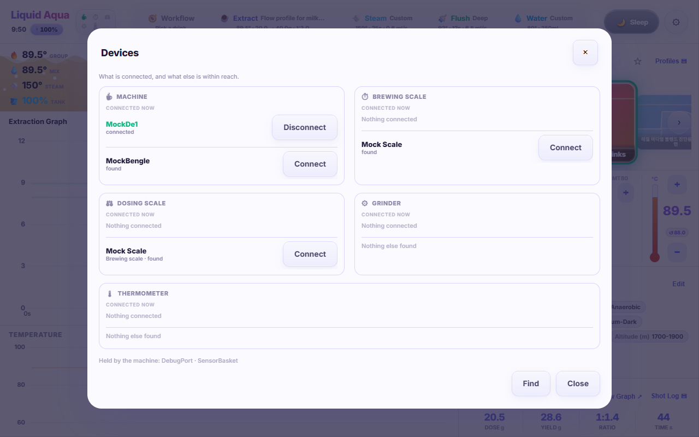

Tap the device button in the top bar. Each kind of device has its own cell, side by side, with what is connected now at the top and what else is **in reach** below it. An empty cell says so in its head and takes no more room. The brewing scale is not offered as the dosing scale, nor the other way round:

| Cell | |
|---|---|
| Machine | the DE1 |
| Brewing scale | the scale a shot is weighed on. The gateway reconnects to it by itself |
| Dosing scale | a second scale to weigh the dose on. It is held for this skin only, never weighs a shot, and is let go when the app closes |
| Grinder | a grinder driven by a plugin |
| Thermometer | appears when a thermometer plugin is on |
| Bean doser | appears when the RedxKey doser plugin is on |

**Find** (next to the close button) looks again without connecting anything. The gateway stops looking once it has a scale, so a scale switched on later is only noticed this way. Devices in reach stay listed while it looks.

**Connecting** a device is given time: up to 45 s for a thermometer, a grinder or the dosing scale, 40 s for the brewing scale. A device the gateway is connecting, whether you asked or it reconnects by itself, reads **Connecting** in the sheet and on the device button. If the gateway answers that the device is no longer listed or that Bluetooth timed out, the skin searches once more (**Searching again…**) and, if the device turns up, asks for it one more time, or waits for it if the gateway is already connecting it. It does this once; a device that does not come back is reported as before. If the skin stops waiting but the device connects a little later, the sheet shows it connected and says so.

The skin never scans by itself, as other skins do not: a scan shares the Bluetooth radio with everything already connected. A dosing scale that is away is looked for when you tap it on the recipe card. What the skin connects by itself waits its turn: the machine first, then the brewing scale, each left to settle, and only then the dosing scale.

---

## Steam, flush and hot water

Tap an action in the top bar to run it, or hold it for its options. Each has up to three named presets. **Save the current numbers as a preset** stores what is on screen.

**While the action runs**, the recipe card turns into live controls for that action's numbers. Changes take effect as you tap, and the skin batches your taps into one write.

The steam, flush and hot water cards are laid out like the shot card: the presets on top, then each number in the same cell as the dose, with − and + on either side, three to a row (steam: temperature, time, flow, then a second row with the milk and its stop. Each follows its own device: the milk's weight, and **→ Shot** with it, only while the dosing scale reads, and the stop only while a milk thermometer is connected. With neither, steam is one row; with one, the second row holds just that cell. They come and go as the devices connect and drop, and the milk weighed and the stop set are kept; flush: temperature, time, flow; hot water: temperature and volume). Steam's thermometer and scale sit on one slim line above them. The grinder card is the shot's, so it steps aside for steam, flush and hot water and comes back for espresso; the bean card stays.

| | |
|---|---|
| Steam | temperature, seconds, flow |
| Flush | temperature, seconds, flow |
| Hot water | temperature, volume, seconds, flow |

The **Hot water** tab in Settings › Machine has, as in Streamline, the flow, one switch to stop on the scale and how early it stops so that the cup lands on the target. Below them, **Hot water log** lists the last pours: the target, what reached the cup (at the stop and after the drips), what the machine counted against the limit it was sent, how long it ran, and what stopped it: this skin on the scale, the button in this skin, the gateway on the scale, the machine's own count, its time limit, a low tank, or something else such as the group head. **Copy** puts the full record, with a flow and weight trace, on the clipboard. Streamline's time limit is not offered: the machine ignores it whenever a volume is set ([decaid #1128](https://github.com/decentespresso/decaid/issues/1128)).

Some machines stop hot water on their own pump count well before the cup reaches the amount, so the gateway's scale stop never gets the chance ([decaid #1119](https://github.com/decentespresso/decaid/issues/1119)). So with a scale and **Stop hot water on the scale** on (the default), the machine is asked for 250 ml, whatever the amount, and the skin stops the pour when the cup reaches the amount, as de1app does; the gateway's own scale stop is left on behind it. A cup put down or lifted mid-pour, or a tare that lands late, is not taken for water. Off, both stops are off and the machine is given the amount and stops on its own estimate; the gateway's switch is shared with other skins, so it changes there too. Without a scale the machine always stops on its own estimate. **Leave the machine's water count out** (off by default, only with the scale stop on and a scale connected) goes further for a machine that counts more water than it gives: the machine is given no volume, only a time limit (the amount at half the set flow, plus 5 s), so its count cannot end the pour before the cup reaches the amount ([decaid #1128](https://github.com/decentespresso/decaid/issues/1128)). If the skin or the scale drops out, water keeps coming until that limit. The amount goes up to 250 ml, the most the machine takes. A pour started at the group head while the skin is not running can give up to 250 ml.

### Milk thermometer


With a thermometer plugin turned on, such as [LEBREW TEMP](https://github.com/SongPaul/lebrew-temp-plugin), the steam card gains two blocks:

- **Milk now**: the thermometer's reading, green once it reaches the target.
- **Milk target** (**Stop at** in its cell): the temperature steaming stops at, from 30 to 90 °C, or *off*. It is saved as the workflow's `steamSettings.stopAtTemperature`, and the gateway stops the steam there. The skin does not send a stop of its own, because a second stop would count as the second tap of the two-tap steam purge and purge straight away.

While steaming, the temperature graph draws the milk in orange with its live reading, and the milk target as a dashed line. Tap **Milk °** in the legend to hide or show it.

With a dosing scale, the steam card also weighs the milk, the way the shot card takes a dose. Until milk is taken, its cell shows what the scale reads, dimmed, with **Tap to take**; a tap takes it once the reading has settled (an amber dot while it moves), and a hold types it. Taken, the cell shows the milk, and a tap takes the scale again. **→ Shot** records that weight in the last shot's notes.

### Bean doser

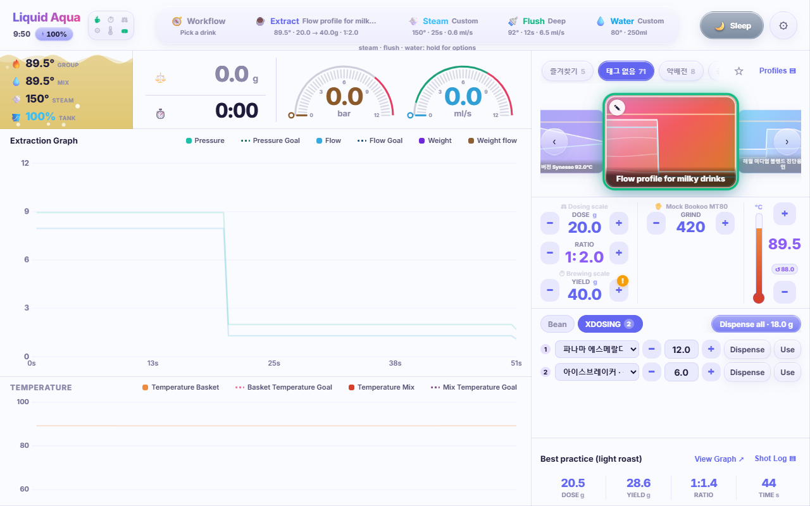

With the RedxKey bean doser plugin (`redxkey.reaplugin`) turned on, the device sheet gains a **Bean doser** cell. Up to four modules can be connected at once, which is the gateway's limit for one plugin. With a module connected, the bean card has two tabs: **Bean** and **XDOSING**, which shows how many modules are connected.

- XDOSING lists every connected module on one line: its number, its bean, its grams, **Dispense** and **Use**. **Dispense all · N g** sits beside the tabs, which stay in place while the list scrolls under them when the modules do not all fit.
- Each module can be given a bean from the bean list. The bean and grams are kept on this tablet under the module's name.
- Grams run from 0 to 25.5 g in 0.1 g steps. A single module with nothing kept starts at the recipe dose.
- A module that pours makes its bean the recipe's bean, so the next shot is saved with it. **Dispense all** takes the bean of the module that poured the most. **Use** does the same without pouring.
- A module's number turns green once it has poured, and amber if it failed or may have poured. A dispense that failed after the start byte was sent may still have poured, so the next dispense on that module asks first.

---

## Monitor


One action at full screen: the graphs worth watching and the numbers worth reading from across the room. It opens itself when an action starts. Settings › General › Display chooses which actions open it, and which close it again when they finish. Tapping the graph opens it at any time.

| | |
|---|---|
| Heading | for a shot, the profile with the bean, grinder and grind beneath. For steam, flush and water, the action itself |
| Weight · Elapsed | large enough to read at a distance |
| The two dials | the same bands as the main screen |
| Recipe | dose → yield and ratio for a shot, or the action's own settings |
| Graphs | Extraction above, Temperature below, on the same time axis |

**Close puts the page away; it does not stop the machine.** While an action runs, the monitor carries its own **Stop**. That Stop is hidden when a GHC is fitted, because the group head owns starting and stopping there. The monitor stays up after the action ends until you close it, so the result can still be read.

---

## Profiles

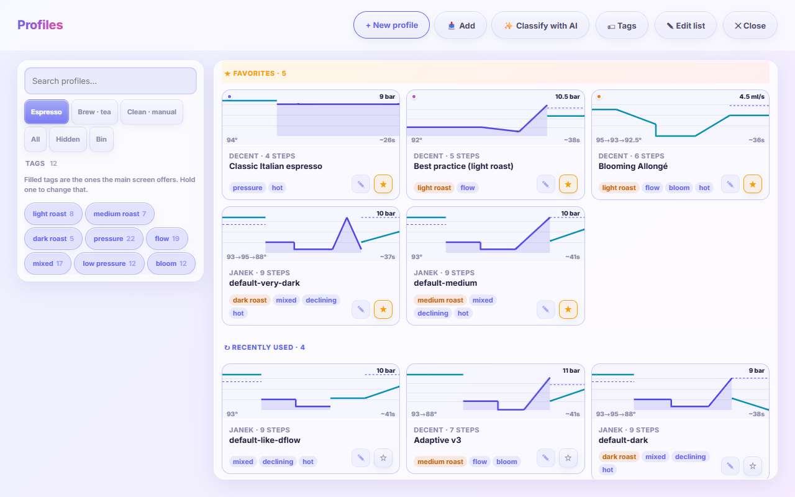

**Profiles** on the main screen opens the list. Every profile is a card with its curve, peak, temperature and expected time.

- **Search** by name or notes. Filter by **Espresso / Brew · tea / Clean · manual / All**, **Hidden**, or the **Bin**.
- Profiles are grouped into **Favourites** and **Recently used**, followed by the rest.
- **Tags** come from each profile's own shape (pressure, flow, mixed, low pressure, bloom, declining, hot, cool), plus any roast level you set. Filled tags are the ones the main screen offers as tabs; hold a tag to change that. **Tags** at the top renames, deletes and picks tags across every profile.
- **✨ Classify with AI** reads the whole catalogue once and tags each profile with a roast level.
- **+ New profile** starts one. **Add** imports profiles from Visualizer (a share code, a shot link, or by browsing the community), from Pourstep, or from `.tcl` and `.json` files, including a whole folder at once.
  - **Pourstep** takes the 4-digit code Pourstep shows for an espresso recipe (“Decaid code”, valid 24 hours). Type it on the keypad and the recipe is added as soon as the fourth digit is in; **Use it now** also loads it. It needs the [Pourstep plugin](https://github.com/SongPaul/pourstep-plugin) installed and turned on.
- **Edit list** selects several profiles to hide, show or delete together. A deleted profile goes to the Bin, where it can be put back. A profile that ships with the app is hidden rather than deleted.

### The editor

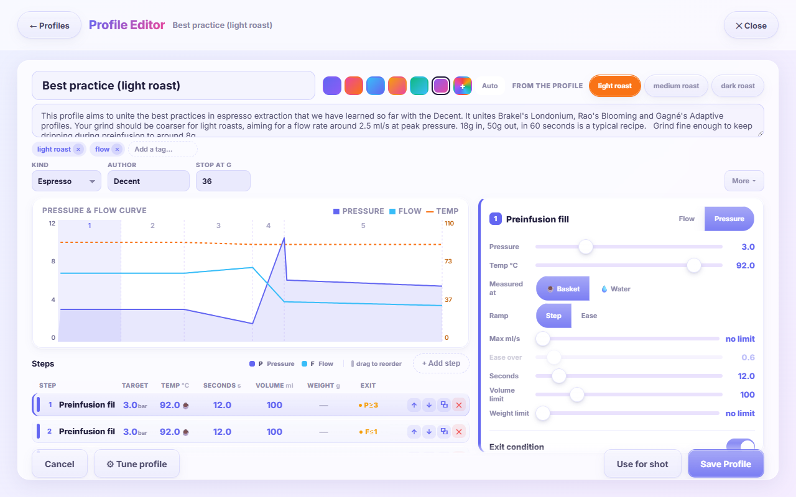

The head is one line: the title, the kind and the weight to stop at. **Details** opens a sheet with the rest: notes, tags, **card colour**, **roast level**, author, the flow calibration and the profile's own stop multipliers. **More** in that sheet opens the remaining fields the profile carries.

- The **curve** shows pressure, flow and temperature for every step. Press a stretch of the curve to edit the step that drew it.
- The **step table** lists every step with its target, temperature, seconds and how it ends: the exit condition (*Pressure ≥ 4*), a weight, a volume, or its time. The number carries the step's kind (pressure or flow). Drag a step by its grip to reorder it.
- The **step panel** on the right edits one step in three groups. **Target**: pressure or flow, the temperature, where it is measured (basket or water) and the ramp (step or ease). **To the next step, whichever comes first**: seconds, the exit condition, and the volume and weight limits. **Limits**: the limiter. A limit that is not set is a chip that adds it; a set one is a chip with its value, and its **✕** takes it off. Sliders open the keypad from the box with the value.
- **⋯** in the panel's head moves the step up or down, duplicates it, or deletes it; delete asks for a second press.
- The step table holds up to 20 steps, as many as the machine can take. Temperatures go in half degrees, and step times in tenths of a second below 12.75 s and whole seconds above, which is what the machine stores; a value in between is rounded where you see it.
- **Tune profile** sends the shots pulled on this profile to the AI. It adjusts only the values of the steps the profile already has; no step is added, removed or renamed. Save the result as a copy, or over the profile as a new version.
- **Use for shot** loads what is on screen, so unsaved edits are what the machine gets. The card's temperature moves the edited steps the same way, so the distances between the temperatures you typed are kept.

**Saving.** **Save Profile** stores what is on screen.

- A changed step saves a **new version**. The version before is hidden, not overwritten, and the gateway keeps the line between them. The profile keeps its star, its card temperature and its own stop multipliers; the card temperature then moves the new version's own step temperatures.
- A new name, notes or author alone keeps the same profile.
- Saving content that is the same as an earlier version brings that version back instead of making another.
- A profile that ships with the app is saved as **your own copy**, named after it with (2), (3) and so on, unless you gave it a name of your own. A new name alone cannot be saved on one of these.
- If the profile is loaded on the machine, the saved version is sent to it straight away, or when the shot ends if one is running.
- While there are unsaved changes the head bar says **Changed**, and Cancel, the way back and Close ask before discarding them.

**Version history.** **Version history** in the save bar lists the profile's saved versions from the gateway's lineage, newest first, with the one open marked **Current**. Each says when it was saved (*Today 14:05*, *Yesterday 18:40*, or the date) and what changed from the version before (*Step 2 pressure 8.0 → 9.0 and 2 more*, a step added or removed, steps reordered, an exit condition added or removed). Tap one to lay its curve, dashed, over the current one; changed cells in the step table show the old value under them. **Restore this version** asks first, then loads that version into the editor without saving it, with **Undo** in the toast. Saving it then makes a new version. Upright, the history is a sheet from the bottom.

---

## Beans and grinders

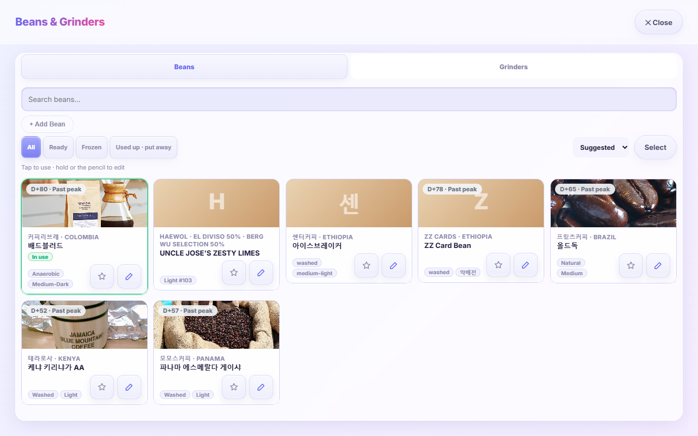

Open it from **Change bean** on the bean card, or by holding the grinder name in the recipe. **Beans | Grinders** in the head switches between the two, and **+ Add bean** (or grinder) beside it starts a new one. Beans and grinders are cards: **tap to use one**, and hold or use the pencil to edit.

- A bean's card shows its bag photo and a badge with its days off roast and how far past roast it is, such as **D+12 · Ready** (**Resting**, **Ready**, **Fading**, **Past peak**, or **Frozen**, in blue, with the days in the freezer left out).
- Filter by **All / Ready / Frozen / Used up**, and order by **Suggested**, roast date or name. **Select** acts on several beans at once: put them away, bring them back, or delete.

### A bean

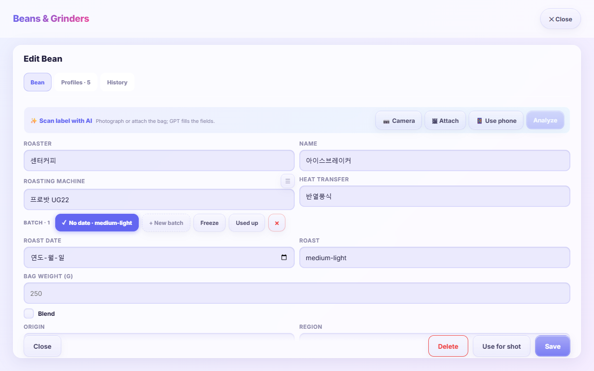

A coffee is one bean. Each time you buy it again is a **batch**, with its own roast date, roast level and bag weight. The bean carries what does not change: roaster, name, roasting machine and its heat transfer, origin, region, producer, processing, variety, altitude, species and decaf. A **blend** lists its coffees with their shares.

- **Freeze** and **Used up** mark the batch. With a bag weight, the card counts the shots and estimates what is left.
- **✨ Scan label with AI** fills the form from photos of the bag (up to five). **Camera** and **Attach** work on the tablet. **Use phone** shows a QR code: photograph the bag on the phone, and the result is saved straight to the gateway. The scan keeps what the bag says, in the bag's language. What it found by searching rather than on the bag is marked for checking. Scanning a coffee you already have offers to add a **new batch** rather than a duplicate bean.
- Up to three bag photos are kept with the bean. They become its cover and fill the [sleep screen](#sleep-screen).
- **Use for shot** puts the bean in the workflow, so every shot records what it was pulled with.

### Profiles for this bean


One list, whatever the source. Each row shows the profile's curve, how many shots you pulled with it on this bean, and when. **Use** loads it, **Edit** opens it in the editor, and **History** shows only the shots pulled with it.

**✨ Suggest a profile for this bean** asks the AI which of *your installed* profiles suits this coffee, and ranks five. The answer is saved with the bean, so reopening it costs no API call.

### This bean so far

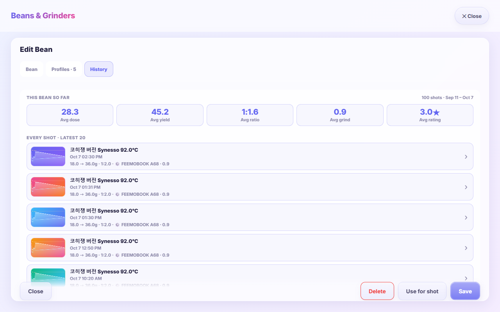

The shot history for this coffee: average dose, yield, ratio, grind and rating, the number of shots and their date range, and the latest 20 shots. Tap one to open it in the shot log.

### Grinders

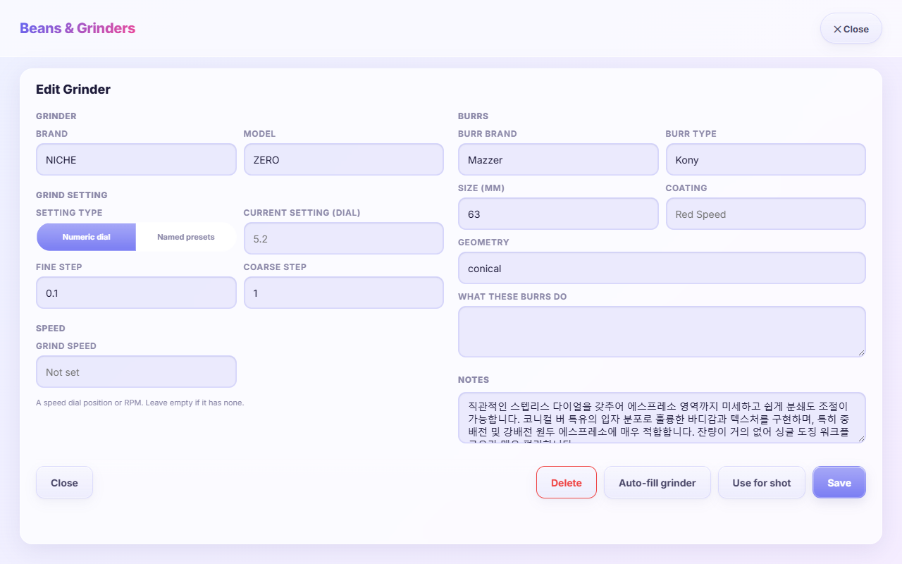

A grinder is a **brand** and a **model**, a grind setting, an optional speed, and its burrs.

- The setting is either a **numeric dial** with your own fine and coarse step, or a list of **named presets**.
- **Burrs** are the burr brand, type, size, coating and geometry, with a note on what they do.
- **Auto-fill grinder** looks the grinder up by brand and model and fills only the empty fields. It is told never to guess a burr size: a grinder it does not recognise comes back empty rather than plausible.
- A grinder driven by a plugin (Bookoo MT80, xBloom, Eureka E64 and others) is added by itself and marked **Linked**. Its name and dial follow the plugin, and the recipe card sets it while it is in use. Settings › Plugins installs grinder plugins.

The AI shot reading and the profile suggestions are both given the grinder, so a grind change is suggested in terms of *your* dial.

---

## Shot log


Every recorded shot, newest first. **All | 4 stars and up** under the search shows every shot, or only those you rated four stars or more among the latest 200. Pick one to see it: its dose, yield, ratio, time and group temperature first, then the recording on the left and the record on the right.

**On the left:** the extraction and temperature graphs as they actually happened, with the steps named along the top, and why the shot ended ("Stopped at the target weight").

**On the right:**

| | |
|---|---|
| AI reading | **Analyse** and **Tune profile** |
| Bean & grinder | the coffee, batch, grinder, grind and speeds the shot was recorded with. Correct them here if the wrong bean was loaded |
| Basket | from your own basket list |
| Tasting log | actual dose and yield, TDS, extraction yield, and a tasting card: acidity, bitterness, sweetness, body, dry finish, aftertaste, and whether you would have another |

At the bottom: **Use as guideline** draws this shot under the live graph. **Upload to Visualizer** sends the shot, or updates it if it is already there. **Save Log** writes it to the gateway.

**By machine** groups your shots by the roaster's machine, its heat transfer and batch size. It is a record of what you dialled in, not a verdict on the machine. A machine typed in different ways (**프로밧 UG22**, **Probat UG22**, **probat ug 22**) is one machine: case and spaces do not count, and a make's Latin name reads as the catalogue's Korean one. The average grind is the group's most used grinder's, at that grinder's precision and in its unit (**417 µm**), and is compared only with the same grinder across the log.

### Comparing shots

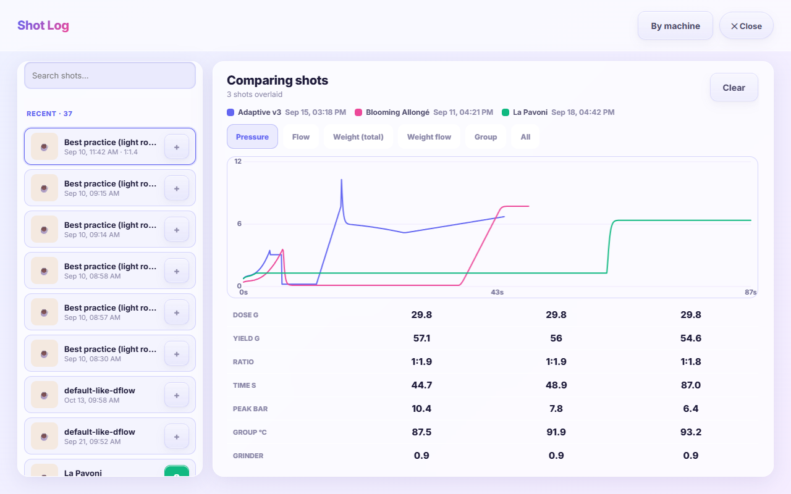

**Compare** above the list turns the rows into ticks: tap shots to add them to a comparison, where each takes a colour and a number, and **Done** leaves the mode. Up to four shots can be compared.

With two or more picked, the detail becomes an overlay: one measurement across every shot on a shared axis. **Pressure / Flow / Weight / Weight flow / Group** picks the measurement, and **All** draws every one at once with dash patterns. Below is a table of dose, yield, ratio, time, peak pressure, group temperature, grind, TDS, EY and rating, one column per shot. **Clear** returns to the single shot.

### Shot feedback


When a shot ends, its pressure, flow and weight are checked right here, with no AI and no network. The last-shot card marks what is off on its numbers, and the shot log shows the full reading for any shot with a recorded curve:

- a verdict: ran normally, ran fast (grind coarse), choked (grind fine), channelled, or mixed signs;
- the shot time, yield and ratio against their targets, puck resistance and extraction yield;
- if the profile ran out before the target weight, how many seconds the last step needs, or the yield to set instead.

**Use next time** in the shot log keeps the suggestion and shows it on the card the next time that profile is loaded. Settings › General › Display turns the feedback on or off.

With a scale, the skin also learns **when to stop**. After each shot it compares the settled weight with the target and moves the stop a little earlier or later. A toast says what it changed, and **Undo** puts it back. Settings › Machine › Stop timing turns this off.

### AI reading

**Analyse** sends the shot to the AI and asks what the curve did. The AI gets the profile, the bean and grinder, the measured figures, your tasting notes and the curve itself, downsampled to about two dozen points. It answers with a verdict, a few observations and up to three changes, each with its reason. It works on a comparison too: what actually differs between these shots, and which one to chase.

- Readings are cached against the shots they were made from, so reopening a shot costs no call.
- Mark a suggestion **Worked** or **Did not**. Those reactions go with the next reading, so it stops repeating what did not work. Settings › AI shows what is remembered and can forget it.

---

## Settings


Settings is a list of categories, each with its own tabs. On an upright tablet or a phone the categories are a row across the top that scrolls sideways.

| Category | Tabs and what is in them |
|---|---|
| **General** | **General**: language, °C/°F, g/oz, night mode and auto night mode, auto-open the shot log, a way back to the Decaid dashboard. **Display**: brightness, keep the screen awake, low-battery dimming, the extraction guideline, which actions open and close the monitor, the shot feedback, screen effects, the frame meter, and the sleep screen's photos, motion and dimming. **Camera**: the camera in the album, and how to turn, fill, enlarge and mirror it |
| **Machine** | Four tabs. **Tank** (refill warning, refill kit); **Flow & stop** (stop timing with the learned shot stop, hot water: flow, scale stop, stopping in the skin, and the machine flow calibration); **Machine settings** (USB charger, fan, tank heater, steam purge, sleep after inactivity); **Care & info** (clean, descale, air purge, machine info, sensor calibration read only) |
| **Scale** | refuse to start without a scale, room to reach the target, and what to do with the scale when the machine sleeps |
| **Phone** | the address and QR code for the [phone app](#phone) |
| **Updates** | **Firmware** (update, or upload a file), **App update** for Decaid, **Skin** release history |
| **AI** | the provider (Gemini, Claude or OpenAI) and its key, with a key check. **What the reader remembers** |
| **Plugins** | installed plugins, and grinder plugins with their GitHub addresses. On Decaid 0.9.2, or once the gateway refuses a change for want of a token, plugins are installed, switched and configured in the Decaid app, and this page says so instead of offering switches that would be refused |


- **Language** offers English and Korean built in, plus thirteen more languages that are translated once with your AI key and kept.
- **Room to reach the target**: when a profile would end on its clock before the target weight, its last step is held up to 20 seconds longer. The shot still stops at the target. The stored profile is not changed.
- **Machine flow calibration**: the DE1 estimates flow from its pump, and this multiplier scales that estimate for espresso as well as hot water. The value is typed on the skin's keypad or stepped by 0.01, written to the machine and read back. It is not worked out from a hot water pour: the machine's hot water error changes with flow, so one pour does not give a calibration ([decaid #1128](https://github.com/decentespresso/decaid/issues/1128)). The last value read is shown at once and refreshed behind it.
- **Screen effects** turns off the moving water, the curved graph's motion, the sheen across a cover, the touch ripple and the glass blur on the other pages, for a tablet that stutters. The **frame meter** shows frames per second; tap it for a log of slow frames and what ran around them.

---

## Sleep screen

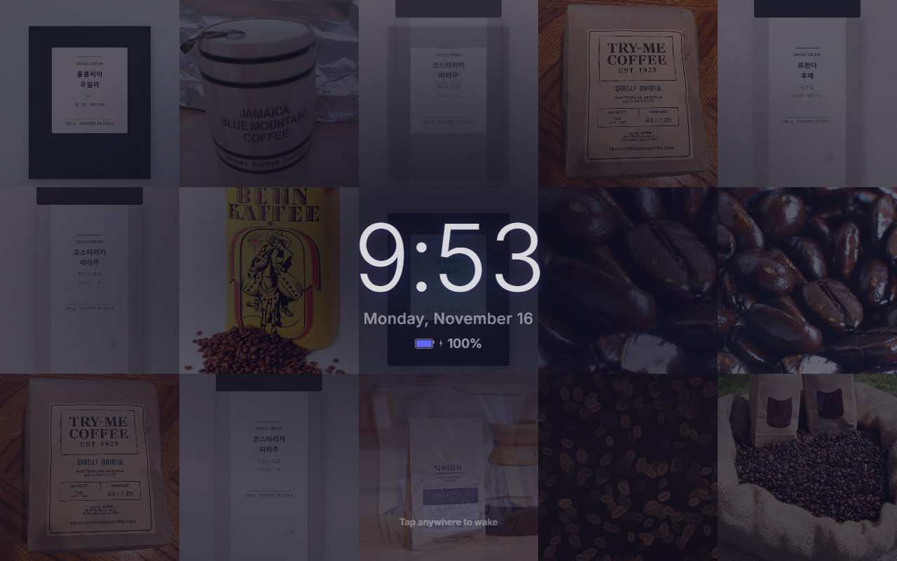

Sleep from the top bar, or let the machine sleep on its own; the skin follows either way. It shows a clock, the date and the battery over a wall of your bag photos. Until there are enough photos, drawn bags make up the numbers. Settings › Display sets whether the wall moves always, in bursts or not at all.

It is built to cost as close to nothing as a screen can:

- the wake lock is released, so the tablet's own display timeout applies;
- the interface behind it stops painting, and every animation stops;
- brightness drops to your sleep level and comes back on wake;
- the sockets with nothing to say while asleep are closed and reopened on wake. Only the machine's state stays open, so a machine woken at the group head is noticed.

The full-screen pages (beans, profiles, the shot log, settings) do the same while they are open: the screen behind them stops painting.

---

## Phone

<p>


</p>

Scan the code in Settings › Phone, or open the address beside it, and the skin shows its phone app. The address is the tablet's IP address; if that changes, scan the code again. When the gateway does not report the address, type the tablet's IP there and press **Make the QR code**. A name such as `decaid.local` can be typed under **Type the address**, but a numeric address is the one that works everywhere. Add the app to the home screen and it opens like an app.

The phone looks like the tablet: the same flat colours, and night when the skin's night setting is on. Its tabs are:

| | |
|---|---|
| **Machine** | the machine's state as the tablet's tank panel shows it, the recipe it has (to read, not to change), the last shot, and wake or sleep |
| **Shots** | the last shots. An open shot shows its graph, dose, yield, ratio and time, **Rate this shot**, and buttons for Visualizer and an AI reading. When the machine is out of reach, it reads your shots from Visualizer instead |
| **Beans** | photograph a bag and add it, or update a bean's batch |
| **Camera** | send this phone's camera, or an IP-camera app's stream, to the album on the tablet |
| **Setup** | the address this phone opens, the phone's own settings, the AI key, and a Visualizer account |

**The phone starts nothing.** It never starts a shot, steam, hot water or a flush, and it does not change the recipe. What it can do is stop: while the machine is pulling a shot, steaming, pouring hot water or flushing, a red **Stop** sits right above the tabs, and it sends the machine to idle at once, without asking first. It also appears when the machine has not answered for more than five seconds; the time at the top then turns amber and the card says it is waiting for the machine. It is not offered to a machine last seen asleep, since idle would wake it. If the stop does not go through, the phone says so and the button is ready again.

**During a shot** the card shows the time, and with a scale the weight against the yield and what is left. Without a scale it says the profile ends the shot. The scale is only listened to while the Machine tab is on screen and a shot is running. **Steaming** shows the time, and with a milk thermometer the milk against the temperature it stops at.

**After a shot** the tab shows the shot just pulled, with the dose, yield, ratio and time from its saved record, and **Rate this shot**. That opens the same record as the tablet's, as a sheet: dose and yield, TDS and extraction yield, the tasting, and notes. The card goes when the next thing starts or after ten minutes.

On a phone that will not give this address a camera, the Camera tab puts the IP-camera app first, and the phone's own camera folds to one line that opens to what would let it.

---

## Where things are stored

**On the gateway**, so every device sees the same thing: the workflow (profile, dose, yield, grinder, coffee), the steam, flush and hot-water settings, beans and batches, grinders, and shots with their tasting notes. A profile's colour, tags and roast level go in its `metadata`, and a bean's saved suggestions and photos in its `extras`.

**The skin's own data** lives in the gateway's key-value store, under the namespace `liquid-aqua`, and the browser keeps a copy. The skin keeps one browser origin across updates, but the phone, another address for the tablet, or a run where Decaid has to fall back to a temporary port each start with an empty `localStorage`. The store is the same for all of them; the local copy makes the skin start instantly and keeps it working when the gateway cannot be reached.

| Key | |
|---|---|
| `prefs` | language, units, night mode, display, monitor and sleep options, AI provider and key |
| `favs` | favourite profiles |
| `presets` | steam, flush and water presets |
| `shotai`, `aifb`, `aipin` | AI readings, your reactions to them, and a suggestion kept for next time |
| `shotread`, `ranout` | the last shot feedback, and profiles that ran out before the target |
| `grindmem`, `gspeed`, `gfeed`, `gburr`, `gbrands` | grind settings per bean, grinder speeds, burrs and brands |
| `baskets`, `rmachines`, `beanfav`, `wfhist` | your basket list, the roasting-machine list, favourite beans, recent workflow choices |
| `i18n` | languages translated with AI |

In the browser the same keys are kept with an `aurora_` prefix.

---

## Troubleshooting

**There is no update button.** On Decaid 0.9.2, or with extension management protection turned on, skin updates are installed from the Decaid app: Web Interface on the dashboard, then the menu at the top right, then Check for updates. From 0.9.3 the button is there unless the gateway has refused it.

**Saves fail and Settings warns about the address.** Decaid 0.9.3 takes settings and extension changes only from a page opened by a number (`localhost`, `127.0.0.1` or the tablet's IP address), not by a name such as `decaid.local`. Open the skin by the address the warning gives.

**The tank is red and the water is not hot.** The tank is at or below the refill level. On a plumbed machine, set *Refill kit* in Settings › Machine › Tank.

**AI buttons do nothing, or take me to Settings.** There is no key for the chosen provider. Settings › AI, then **Check the key**.

**The yield has an amber !.** The loaded profile will probably end before that weight. Tap it to match the yield, or give the profile more room in the editor.

**A second scale is not found.** Turn it on, then **Find** in Devices. The gateway stops looking once it has one scale.

**The phone QR opens a page that cannot reach the gateway.** The tablet's address may have changed, or the gateway is reporting one the phone cannot see. Scan the code again, or type the tablet's IP under **Type the address** in Settings › Phone.

**The screen stutters.** Turn off *Screen effects* in Settings › General › Display. The frame meter there shows how smoothly the tablet runs.

**Everything is tiny or clipped.** The skin lays out at 1280×800 and scales to fit. Very narrow windows letterbox rather than reflow, except on a phone, which gets the phone app.

---

## Development

```
index.html             the entire skin
skin-manifest.json     id, name, description, version
sw.js                  the service worker that caches the skin
de1-translations.csv   Decent's official translations, used to seed AI translation
inter-*.woff2          the interface font, so nothing is fetched from the internet
sample-bags.json       drawn bags for the sleep screen
docs/                  screenshots for this README
tools/test/            headless browser tests
```

No build and no package manager: edit `index.html` and reload. `python tools/test/run.py` runs the browser tests against a gateway on `127.0.0.1:8080`. The tests never write to the gateway; see [tools/test/README.md](tools/test/README.md).

Conventions that keep it coherent:

- Every control is at least 40 px on its shortest side, and nothing renders below 11 px.
- One gradient-filled control per view, for the primary action. Everything else that carries the accent colour is tinted, not filled.
- Values are the content and buttons are chrome: the number is larger than the buttons around it.
- Layout is a fixed 1280×800 stage. If something new does not fit, something else gives up height on purpose.

## License

MIT
